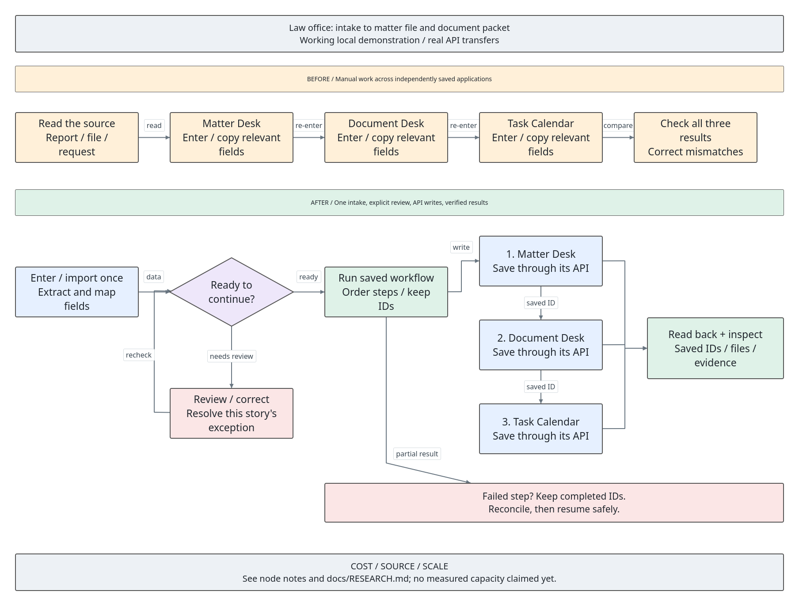
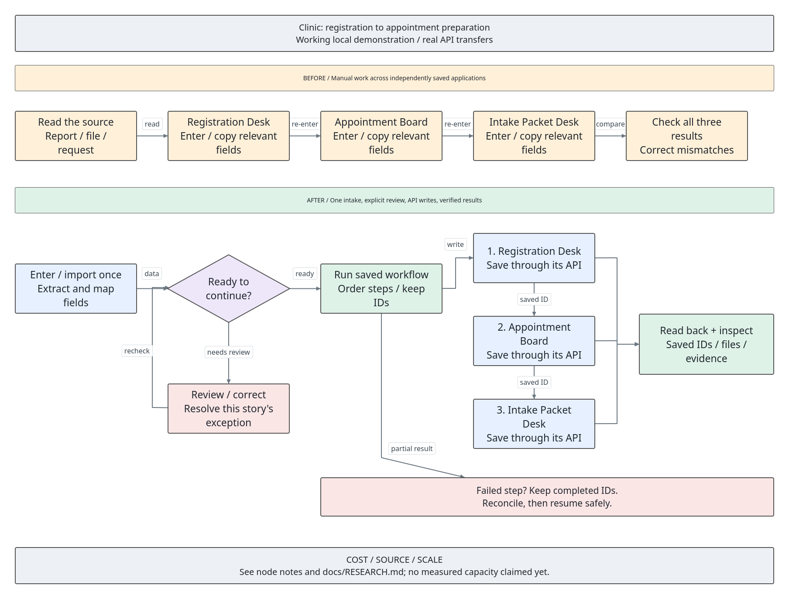
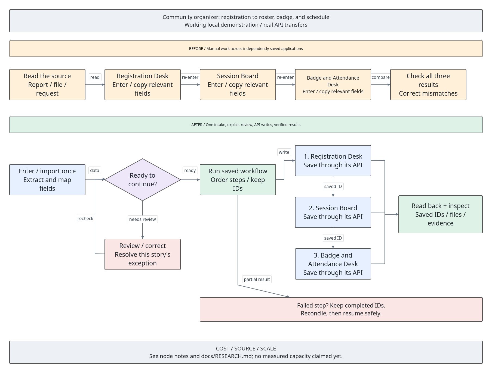

# Detailed workflow catalog

Generated from [scenarios.json](scenarios.json).

Status: eight implemented local workflows with actual browser evidence. Vendor products remain researched integration candidates.

Provider capabilities and costs are documented in [RESEARCH.md](RESEARCH.md).
Local API paths below are implemented workplace interfaces, not vendor endpoint claims.

## HVAC: one service call, three systems

**Person:** Maya, dispatcher at the fictional Desert Air service company.

A customer reports an AC unit that is blowing warm air. The dispatcher books a visit, maintains the customer record, and prepares billing; a technician later records the completed work.

### Inputs and systems

- Generated labelled intake PDF and editable sample facts
- Generated messy XLSX/CSV with original rows, normalization, duplicate flags, and review

**Apps:** Customer Profiles / Dispatch Desk / Billing Desk.

**Repeated facts:** Customer reference, Full name, Phone, Email, Street, City, Region, Postal code.

### Manual workflow

1. Open Customer Profiles, enter its 9 source fields, and save to its independent store.
2. Open Dispatch Desk, enter its 13 source fields, and save to its independent store.
3. Open Billing Desk, enter its 10 source fields, and save to its independent store.
4. Compare the three saved records and download each populated document. Reconcile mistakes by returning to the source facts.

### Automated workflow

1. Enter or import the source once; inspect original and normalized values, map fields, and correct review flags.
2. Validate the shared intake and persist a job with source provenance and business identity.
3. POST each mapped record to its own local workplace HTTP API, retaining the returned IDs for later steps.
4. GET each saved record and compare its payload. Keep successful steps when a later destination fails.
5. Apply a uniquely referenced completion event. Update the existing billing draft with diagnostic fee, approved labor, and parts. Reuse the customer for later jobs.

### Mapping and operations

- Customer reference -> hvac-0.customer_ref -> hvac-1.external_customer_ref -> hvac-2.account_ref
- Full name -> hvac-0.display_name -> hvac-1.contact_name -> hvac-2.addressee
- Phone -> hvac-0.phone -> hvac-1.contact_phone -> hvac-2.recipient_phone
- Run ID + stage -> idempotent operation ID; verified upstream record IDs -> downstream _linked_records metadata.

| Application | Implemented demo operation | Inspectable output |
| --- | --- | --- |
| Customer Profiles | `POST /v1/hvac-0/records` | Customer profile with linked service history |
| Dispatch Desk | `POST /v1/hvac-1/records` | Dispatch job and printable work order |
| Billing Desk | `POST /v1/hvac-2/records` | Billing draft with a downloadable invoice preview |

### Rules and failure demonstration

- A technician/time combination can be reserved by one job.
- Customer reference is the explicit matching key; no fuzzy identity decision is implied.
- Invoices stay drafts. Unique completion events apply approved labor and parts; payment is not charged.

**Failure:** Revoke access or take the third destination offline. The API returns 403/503; restore it and resume the saved job without rewriting completed stages. Apply a uniquely referenced completion event. Update the existing billing draft with diagnostic fee, approved labor, and parts. Reuse the customer for later jobs.

### Cost and scalability

The three local apps and standard-library processing require $0 service fees. Poppler/Tesseract are free local tools. Business vendors listed in the research are documented candidates, not connected services.

Queue each job, persist the customer/job/invoice ID mapping, and serialize reservations for the same technician. Measure throughput on this machine before claiming capacity.

**Research entries:** `baserow`, `erpnext`, `libreoffice`, `mailpit`.

### Before/after evidence

- Actual browser captures show source paperwork, all three manually typed/saved forms, one intake, three automated records, HTTP proof, and failure/recovery.
- The capture manifest records timestamps, URLs, modes, record IDs, source type, and file hashes.
- Processing milliseconds are measured per run. Field-entry counts are structural comparisons, not human timing claims.

Apply the ten-position [capture plan](EVIDENCE_PLAN.md) to this story.

## Sports: a personal report that refreshes itself

**Person:** Alex, a fictional sports follower who wants a regular report.

Alex follows selected football teams, checks fixtures and results, updates a personal worksheet, and prepares a short daily digest. Driver-level historical F1 analysis is a separate free data option.

### Inputs and systems

- Generated labelled intake PDF and editable sample facts
- Generated messy XLSX/CSV with original rows, normalization, duplicate flags, and review
- Actual OpenF1 historical session 9158 / driver 1, with a timestamped offline recording

**Apps:** Sports Worksheet / Schedule Board / Report Inbox.

**Repeated facts:** Event reference, Team / driver, Event / session, Event date.

### Manual workflow

1. Open Sports Worksheet, enter its 6 source fields, and save to its independent store.
2. Open Schedule Board, enter its 5 source fields, and save to its independent store.
3. Open Report Inbox, enter its 8 source fields, and save to its independent store.
4. Compare the three saved records and download each populated document. Reconcile mistakes by returning to the source facts.

### Automated workflow

1. Enter or import the source once; inspect original and normalized values, map fields, and correct review flags.
2. Validate the shared intake and persist a job with source provenance and business identity.
3. POST each mapped record to its own local workplace HTTP API, retaining the returned IDs for later steps.
4. GET each saved record and compare its payload. Keep successful steps when a later destination fails.
5. Optionally fetch OpenF1 historical driver/session/lap data. Review the provider date, compute the best positive lap duration, and export a calendar file or local briefing.

### Mapping and operations

- Event reference -> sports-0.event_ref -> sports-1.event_ref -> sports-2.event_ref
- Team / driver -> sports-0.team -> sports-1.team -> sports-2.team
- Event / session -> sports-0.event_name -> sports-1.event_name -> sports-2.event_name
- Run ID + stage -> idempotent operation ID; verified upstream record IDs -> downstream _linked_records metadata.

| Application | Implemented demo operation | Inspectable output |
| --- | --- | --- |
| Sports Worksheet | `POST /v1/sports-0/records` | Updated worksheet with source references |
| Schedule Board | `POST /v1/sports-1/records` | Personal event schedule |
| Report Inbox | `POST /v1/sports-2/records` | Dated report with links to its inputs |

### Rules and failure demonstration

- Provider event date and retrieval time are distinct.
- OpenF1 historical reads need no key; paid live access is excluded.
- Recipient details are synthetic; provider facts retain provenance.

**Failure:** Revoke access or take the third destination offline. The API returns 403/503; restore it and resume the saved job without rewriting completed stages. Optionally fetch OpenF1 historical driver/session/lap data. Review the provider date, compute the best positive lap duration, and export a calendar file or local briefing.

### Cost and scalability

The three local apps and standard-library processing require $0 service fees. Poppler/Tesseract are free local tools. Business vendors listed in the research are documented candidates, not connected services. OpenF1 historical access is free; the paid live service is excluded.

Each historical refresh makes three GET requests. A five-minute timer running for a full day makes 3 x 288 = 864 provider requests before retries; this is arithmetic, not a provider quota or a throughput benchmark. Unchanged mapped input reuses the saved run. Production fan-out would need shared caching, provider-aware rate limits, and bounded queues.

**Research entries:** `football`, `openf1`, `balldontlie`, `libreoffice`, `mailpit`.

### Before/after evidence

- Actual browser captures show source paperwork, all three manually typed/saved forms, one intake, three automated records, HTTP proof, and failure/recovery.
- The capture manifest records timestamps, URLs, modes, record IDs, source type, and file hashes.
- Processing milliseconds are measured per run. Field-entry counts are structural comparisons, not human timing claims.

Apply the ten-position [capture plan](EVIDENCE_PLAN.md) to this story.

## Law office: intake to matter file and document packet

**Person:** Jordan, intake coordinator at a fictional law office.

An intake packet contains client details, other parties, a matter description, and an explicitly stated appointment date. Staff repeatedly copy it into their matter system, document templates, and task calendar.

### Inputs and systems

- Generated labelled intake PDF and editable sample facts
- Generated messy XLSX/CSV with original rows, normalization, duplicate flags, and review

**Apps:** Matter Desk / Document Desk / Task Calendar.

**Repeated facts:** Matter reference, Client name, Client email, Matter description.

### Manual workflow

1. Open Matter Desk, enter its 7 source fields, and save to its independent store.
2. Open Document Desk, enter its 6 source fields, and save to its independent store.
3. Open Task Calendar, enter its 5 source fields, and save to its independent store.
4. Compare the three saved records and download each populated document. Reconcile mistakes by returning to the source facts.

### Automated workflow

1. Enter or import the source once; inspect original and normalized values, map fields, and correct review flags.
2. Validate the shared intake and persist a job with source provenance and business identity.
3. POST each mapped record to its own local workplace HTTP API, retaining the returned IDs for later steps.
4. GET each saved record and compare its payload. Keep successful steps when a later destination fails.
5. A seeded possible party match holds the intake until the reviewer records a decision. Generate a populated administrative client packet and dated task.

### Mapping and operations

- Matter reference -> legal-0.matter_ref -> legal-1.matter_ref -> legal-2.matter_ref
- Client name -> legal-0.display_name -> legal-1.contact_name -> legal-2.addressee
- Client email -> legal-0.email -> legal-1.contact_email -> legal-2.delivery_email
- Run ID + stage -> idempotent operation ID; verified upstream record IDs -> downstream _linked_records metadata.

| Application | Implemented demo operation | Inspectable output |
| --- | --- | --- |
| Matter Desk | `POST /v1/legal-0/records` | Matter record with review outcome |
| Document Desk | `POST /v1/legal-1/records` | Generated document packet |
| Task Calendar | `POST /v1/legal-2/records` | Linked appointment and follow-up tasks |

### Rules and failure demonstration

- Existing demo client is the seeded possible-party-match trigger.
- Reviewer confirmation is required; it does not bypass missing fields or invalid dates.
- Documents and tasks are administrative demo outputs; no legal filing occurs.

**Failure:** Revoke access or take the third destination offline. The API returns 403/503; restore it and resume the saved job without rewriting completed stages. A seeded possible party match holds the intake until the reviewer records a decision. Generate a populated administrative client packet and dated task.

### Cost and scalability

The three local apps and standard-library processing require $0 service fees. Poppler/Tesseract are free local tools. Business vendors listed in the research are documented candidates, not connected services.

Isolate interview sessions by matter, queue document generation, and index the party search. Measure document latency and review backlog separately.

**Research entries:** `docassemble`, `baserow`, `nextcloud`, `libreoffice`.

### Before/after evidence

- Actual browser captures show source paperwork, all three manually typed/saved forms, one intake, three automated records, HTTP proof, and failure/recovery.
- The capture manifest records timestamps, URLs, modes, record IDs, source type, and file hashes.
- Processing milliseconds are measured per run. Field-entry counts are structural comparisons, not human timing claims.

Apply the ten-position [capture plan](EVIDENCE_PLAN.md) to this story.

## Clinic: registration to appointment preparation

**Person:** Riley, receptionist at a fictional outpatient clinic.

A new patient's registration and referral arrive as documents. The receptionist enters demographics, schedules a visit, and prepares an administrative intake packet.

### Inputs and systems

- Generated labelled intake PDF and editable sample facts
- Generated messy XLSX/CSV with original rows, normalization, duplicate flags, and review

**Apps:** Registration Desk / Appointment Board / Intake Packet Desk.

**Repeated facts:** Patient reference, Patient name, Date of birth, Phone.

### Manual workflow

1. Open Registration Desk, enter its 6 source fields, and save to its independent store.
2. Open Appointment Board, enter its 7 source fields, and save to its independent store.
3. Open Intake Packet Desk, enter its 7 source fields, and save to its independent store.
4. Compare the three saved records and download each populated document. Reconcile mistakes by returning to the source facts.

### Automated workflow

1. Enter or import the source once; inspect original and normalized values, map fields, and correct review flags.
2. Validate the shared intake and persist a job with source provenance and business identity.
3. POST each mapped record to its own local workplace HTTP API, retaining the returned IDs for later steps.
4. GET each saved record and compare its payload. Keep successful steps when a later destination fails.
5. Reserve the selected provider and time atomically. A competing patient cannot receive the occupied slot; correct the input and rerun.

### Mapping and operations

- Patient reference -> clinic-0.patient_ref -> clinic-1.patient_ref -> clinic-2.patient_ref
- Patient name -> clinic-0.display_name -> clinic-1.contact_name -> clinic-2.addressee
- Date of birth -> clinic-0.birth_date -> clinic-1.birth_date -> clinic-2.birth_date
- Run ID + stage -> idempotent operation ID; verified upstream record IDs -> downstream _linked_records metadata.

| Application | Implemented demo operation | Inspectable output |
| --- | --- | --- |
| Registration Desk | `POST /v1/clinic-0/records` | Verified demographic record |
| Appointment Board | `POST /v1/clinic-1/records` | Linked appointment |
| Intake Packet Desk | `POST /v1/clinic-2/records` | Administrative packet with source referral |

### Rules and failure demonstration

- All patient information is synthetic.
- Provider/slot allocation is transactional and rejects double booking.
- The generated packet is administrative; no clinical decisions are made.

**Failure:** Revoke access or take the third destination offline. The API returns 403/503; restore it and resume the saved job without rewriting completed stages. Reserve the selected provider and time atomically. A competing patient cannot receive the occupied slot; correct the input and rerun.

### Cost and scalability

The three local apps and standard-library processing require $0 service fees. Poppler/Tesseract are free local tools. Business vendors listed in the research are documented candidates, not connected services.

Separate per-patient work, enforce reservations at save time, and keep document processing out of the appointment request path. Measure contention as well as request speed.

**Research entries:** `openemr`, `libreoffice`, `mailpit`.

### Before/after evidence

- Actual browser captures show source paperwork, all three manually typed/saved forms, one intake, three automated records, HTTP proof, and failure/recovery.
- The capture manifest records timestamps, URLs, modes, record IDs, source type, and file hashes.
- Processing milliseconds are measured per run. Field-entry counts are structural comparisons, not human timing claims.

Apply the ten-position [capture plan](EVIDENCE_PLAN.md) to this story.

## Store: receive stock and update the online catalog

**Person:** Sam, manager of a fictional neighborhood shop.

A supplier delivery includes a packing slip and purchase-order reference. Staff count the delivery, update stock, update online availability, and prepare a purchasing reconciliation.

### Inputs and systems

- Generated labelled intake PDF and editable sample facts
- Generated messy XLSX/CSV with original rows, normalization, duplicate flags, and review

**Apps:** Receiving Desk / Stock Ledger / Online Catalog.

**Repeated facts:** Receipt reference, Internal SKU, Item name, Counted quantity.

### Manual workflow

1. Open Receiving Desk, enter its 7 source fields, and save to its independent store.
2. Open Stock Ledger, enter its 6 source fields, and save to its independent store.
3. Open Online Catalog, enter its 5 source fields, and save to its independent store.
4. Compare the three saved records and download each populated document. Reconcile mistakes by returning to the source facts.

### Automated workflow

1. Enter or import the source once; inspect original and normalized values, map fields, and correct review flags.
2. Validate the shared intake and persist a job with source provenance and business identity.
3. POST each mapped record to its own local workplace HTTP API, retaining the returned IDs for later steps.
4. GET each saved record and compare its payload. Keep successful steps when a later destination fails.
5. Receipt identity prevents duplicate stock increments. Derive available quantity from stock minus reserved units and save that value to the storefront.

### Mapping and operations

- Receipt reference -> retail-0.receipt_ref -> retail-1.receipt_ref -> retail-2.receipt_ref
- Internal SKU -> retail-0.sku -> retail-1.sku -> retail-2.sku
- Item name -> retail-0.item_name -> retail-1.item_name -> retail-2.item_name
- Run ID + stage -> idempotent operation ID; verified upstream record IDs -> downstream _linked_records metadata.

| Application | Implemented demo operation | Inspectable output |
| --- | --- | --- |
| Receiving Desk | `POST /v1/retail-0/records` | Accepted receipt and discrepancy report |
| Stock Ledger | `POST /v1/retail-1/records` | Updated stock ledger |
| Online Catalog | `POST /v1/retail-2/records` | Matching online availability |

### Rules and failure demonstration

- The demonstration SKU catalog is FLT-20, KIT-07, and BOLT-12.
- A repeated receipt cannot increment stock again; changed receipt quantities need a new reference.
- Reserved stock cannot exceed on-hand stock.

**Failure:** Revoke access or take the third destination offline. The API returns 403/503; restore it and resume the saved job without rewriting completed stages. Receipt identity prevents duplicate stock increments. Derive available quantity from stock minus reserved units and save that value to the storefront.

### Cost and scalability

The three local apps and standard-library processing require $0 service fees. Poppler/Tesseract are free local tools. Business vendors listed in the research are documented candidates, not connected services.

Process large receipts in bounded batches and serialize movements for the same SKU. Respect webhook retries and measure reconciliation throughput locally.

**Research entries:** `woocommerce`, `erpnext`, `libreoffice`.

### Before/after evidence

- Actual browser captures show source paperwork, all three manually typed/saved forms, one intake, three automated records, HTTP proof, and failure/recovery.
- The capture manifest records timestamps, URLs, modes, record IDs, source type, and file hashes.
- Processing milliseconds are measured per run. Field-entry counts are structural comparisons, not human timing claims.

Apply the ten-position [capture plan](EVIDENCE_PLAN.md) to this story.

## Individual seller: one item record to listing and sale paperwork

**Person:** Casey, a fictional person selling used household items.

A seller repeatedly types a used item's description, condition, price, and dimensions into a listing, inventory sheet, and packing paperwork.

### Inputs and systems

- Generated labelled intake PDF and editable sample facts
- Generated messy XLSX/CSV with original rows, normalization, duplicate flags, and review

**Apps:** Item Register / Listing Desk / Sales and Packing Desk.

**Repeated facts:** Item SKU, Listing title, Price (USD), Weight (kg), Dimensions.

### Manual workflow

1. Open Item Register, enter its 7 source fields, and save to its independent store.
2. Open Listing Desk, enter its 7 source fields, and save to its independent store.
3. Open Sales and Packing Desk, enter its 7 source fields, and save to its independent store.
4. Compare the three saved records and download each populated document. Reconcile mistakes by returning to the source facts.

### Automated workflow

1. Enter or import the source once; inspect original and normalized values, map fields, and correct review flags.
2. Validate the shared intake and persist a job with source provenance and business identity.
3. POST each mapped record to its own local workplace HTTP API, retaining the returned IDs for later steps.
4. GET each saved record and compare its payload. Keep successful steps when a later destination fails.
5. A unique sale event decrements the one-off item to zero, marks the local listing sold, and fills the packing slip. A second distinct sale fails.

### Mapping and operations

- Item SKU -> reseller-0.sku -> reseller-1.sku -> reseller-2.sku
- Listing title -> reseller-0.title -> reseller-1.title -> reseller-2.title
- Price (USD) -> reseller-0.price -> reseller-1.price -> reseller-2.price
- Run ID + stage -> idempotent operation ID; verified upstream record IDs -> downstream _linked_records metadata.

| Application | Implemented demo operation | Inspectable output |
| --- | --- | --- |
| Item Register | `POST /v1/reseller-0/records` | Item record with linked draft listing |
| Listing Desk | `POST /v1/reseller-1/records` | Sold or reserved inventory state |
| Sales and Packing Desk | `POST /v1/reseller-2/records` | Packing slip and sale record |

### Rules and failure demonstration

- Each unique item starts with one unit.
- A sale needs a unique event reference and an available unit.
- Listings and packing paperwork are local drafts; no marketplace or carrier is contacted.

**Failure:** Revoke access or take the third destination offline. The API returns 403/503; restore it and resume the saved job without rewriting completed stages. A unique sale event decrements the one-off item to zero, marks the local listing sold, and fills the packing slip. A second distinct sale fails.

### Cost and scalability

The three local apps and standard-library processing require $0 service fees. Poppler/Tesseract are free local tools. Business vendors listed in the research are documented candidates, not connected services.

Use item-level reservations and stable event IDs. Load-test owned local services, not the shared eBay sandbox.

**Research entries:** `woocommerce`, `ebay`, `libreoffice`, `mailpit`.

### Before/after evidence

- Actual browser captures show source paperwork, all three manually typed/saved forms, one intake, three automated records, HTTP proof, and failure/recovery.
- The capture manifest records timestamps, URLs, modes, record IDs, source type, and file hashes.
- Processing milliseconds are measured per run. Field-entry counts are structural comparisons, not human timing claims.

Apply the ten-position [capture plan](EVIDENCE_PLAN.md) to this story.

## Property manager: repair request to contractor and owner report

**Person:** Morgan, coordinator for a fictional small property portfolio.

A tenant reports a leak. The coordinator copies unit details into a repair ticket, contractor job, and expense report, then matches the completion invoice back to the work.

### Inputs and systems

- Generated labelled intake PDF and editable sample facts
- Generated messy XLSX/CSV with original rows, normalization, duplicate flags, and review

**Apps:** Property Desk / Contractor Board / Owner Report Desk.

**Repeated facts:** Ticket reference, Property reference, Unit, Reported issue.

### Manual workflow

1. Open Property Desk, enter its 6 source fields, and save to its independent store.
2. Open Contractor Board, enter its 8 source fields, and save to its independent store.
3. Open Owner Report Desk, enter its 6 source fields, and save to its independent store.
4. Compare the three saved records and download each populated document. Reconcile mistakes by returning to the source facts.

### Automated workflow

1. Enter or import the source once; inspect original and normalized values, map fields, and correct review flags.
2. Validate the shared intake and persist a job with source provenance and business identity.
3. POST each mapped record to its own local workplace HTTP API, retaining the returned IDs for later steps.
4. GET each saved record and compare its payload. Keep successful steps when a later destination fails.
5. Match a contractor invoice to its ticket and approved estimate. Mismatched references or an unapproved overage stop before the follow-up writes.

### Mapping and operations

- Ticket reference -> property-0.ticket_ref -> property-1.ticket_ref -> property-2.ticket_ref
- Property reference -> property-0.property_ref -> property-1.property_ref -> property-2.property_ref
- Unit -> property-0.unit -> property-1.unit -> property-2.unit
- Run ID + stage -> idempotent operation ID; verified upstream record IDs -> downstream _linked_records metadata.

| Application | Implemented demo operation | Inspectable output |
| --- | --- | --- |
| Property Desk | `POST /v1/property-0/records` | Tracked property repair ticket |
| Contractor Board | `POST /v1/property-1/records` | Contractor work order |
| Owner Report Desk | `POST /v1/property-2/records` | Owner report with matched invoice |

### Rules and failure demonstration

- Invoice job reference must match the repair ticket.
- An amount above the approved estimate is held for review.
- A matched invoice updates local records without making a payment.

**Failure:** Revoke access or take the third destination offline. The API returns 403/503; restore it and resume the saved job without rewriting completed stages. Match a contractor invoice to its ticket and approved estimate. Mismatched references or an unapproved overage stop before the follow-up writes.

### Cost and scalability

The three local apps and standard-library processing require $0 service fees. Poppler/Tesseract are free local tools. Business vendors listed in the research are documented candidates, not connected services.

Partition work by property, index job references, and queue document extraction. Show the limit imposed by document size and local disk/CPU.

**Research entries:** `baserow`, `nextcloud`, `libreoffice`.

### Before/after evidence

- Actual browser captures show source paperwork, all three manually typed/saved forms, one intake, three automated records, HTTP proof, and failure/recovery.
- The capture manifest records timestamps, URLs, modes, record IDs, source type, and file hashes.
- Processing milliseconds are measured per run. Field-entry counts are structural comparisons, not human timing claims.

Apply the ten-position [capture plan](EVIDENCE_PLAN.md) to this story.

## Community organizer: registration to roster, badge, and schedule

**Person:** Avery, organizer of a fictional neighborhood workshop.

Registrations arrive in a form or spreadsheet. The organizer repeats attendee details in a roster, badge template, and session schedule, then records attendance.

### Inputs and systems

- Generated labelled intake PDF and editable sample facts
- Generated messy XLSX/CSV with original rows, normalization, duplicate flags, and review
- Actual Google developer sample Sheet export; names/majors map to attendees/sessions, other facts are labelled defaults

**Apps:** Registration Desk / Session Board / Badge and Attendance Desk.

**Repeated facts:** Registration reference, Attendee name, Email, Session.

### Manual workflow

1. Open Registration Desk, enter its 5 source fields, and save to its independent store.
2. Open Session Board, enter its 6 source fields, and save to its independent store.
3. Open Badge and Attendance Desk, enter its 6 source fields, and save to its independent store.
4. Compare the three saved records and download each populated document. Reconcile mistakes by returning to the source facts.

### Automated workflow

1. Enter or import the source once; inspect original and normalized values, map fields, and correct review flags.
2. Validate the shared intake and persist a job with source provenance and business identity.
3. POST each mapped record to its own local workplace HTTP API, retaining the returned IDs for later steps.
4. GET each saved record and compare its payload. Keep successful steps when a later destination fails.
5. Allocate the session seat or mark the attendee waitlisted. Only an attendee with a reserved seat can be checked in.

### Mapping and operations

- Registration reference -> events-0.registration_ref -> events-1.registration_ref -> events-2.registration_ref
- Attendee name -> events-0.display_name -> events-1.contact_name -> events-2.addressee
- Email -> events-0.email -> events-1.contact_email -> events-2.delivery_email
- Run ID + stage -> idempotent operation ID; verified upstream record IDs -> downstream _linked_records metadata.

| Application | Implemented demo operation | Inspectable output |
| --- | --- | --- |
| Registration Desk | `POST /v1/events-0/records` | Deduplicated registration roster |
| Session Board | `POST /v1/events-1/records` | Session allocations and waitlist |
| Badge and Attendance Desk | `POST /v1/events-2/records` | Badges and attendance report |

### Rules and failure demonstration

- Registration reference is the stable business key when supplied.
- Capacity allocation is transactional; full sessions become waitlisted.
- Check-in requires an existing reserved seat.

**Failure:** Revoke access or take the third destination offline. The API returns 403/503; restore it and resume the saved job without rewriting completed stages. Allocate the session seat or mark the attendee waitlisted. Only an attendee with a reserved seat can be checked in.

### Cost and scalability

The three local apps and standard-library processing require $0 service fees. Poppler/Tesseract are free local tools. Business vendors listed in the research are documented candidates, not connected services. The public Google CSV export requires no account or key; availability is controlled by Google.

Batch file imports, serialize seat allocation per session, and queue badge rendering. Benchmark realistic event sizes on the available machine.

**Research entries:** `baserow`, `nextcloud`, `libreoffice`, `mailpit`.

### Before/after evidence

- Actual browser captures show source paperwork, all three manually typed/saved forms, one intake, three automated records, HTTP proof, and failure/recovery.
- The capture manifest records timestamps, URLs, modes, record IDs, source type, and file hashes.
- Processing milliseconds are measured per run. Field-entry counts are structural comparisons, not human timing claims.

Apply the ten-position [capture plan](EVIDENCE_PLAN.md) to this story.
