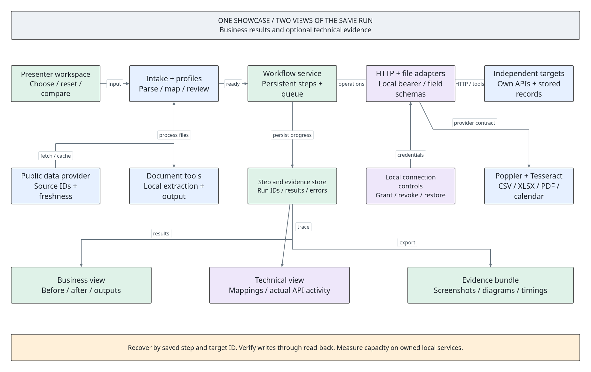
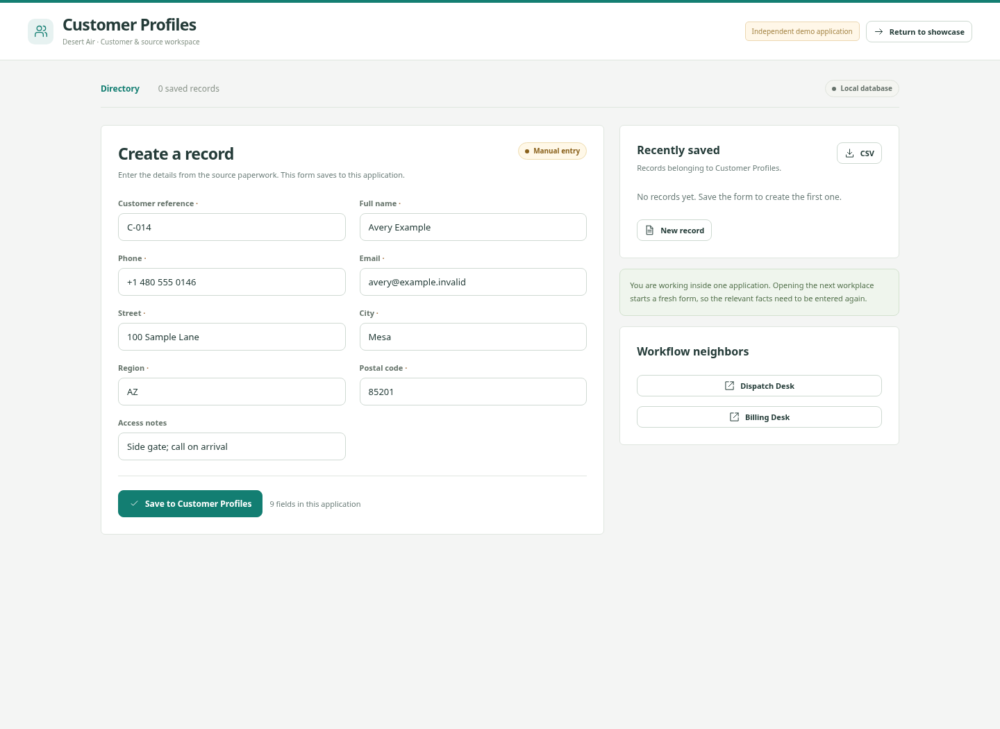
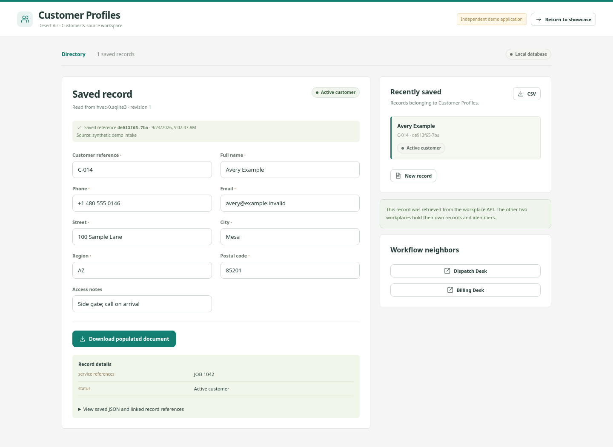

# The Works

The complete Relayworks operator's book and hands-on checklist.

This book starts at your desktop. It teaches you how to open the project, understand each screen, type the manual examples, run the automation, break a handoff deliberately, recover it, and explain the guts. You do not need to supply a spreadsheet, create an account, buy software, or know programming to complete the main lessons.

Every checkbox is something for **you** to do or verify. Checking a box records your progress in this book; it does not execute an action in Relayworks. Keep this book in one browser tab and the demo in another. The named buttons below are the labels in the actual application.

## 00. How to use this book

### Your controls

- [ ] Find **Contents** on the left. On a narrow window, click **Contents** in the top bar to reveal it. The numbered chapters are your table of contents.
- [ ] Click a chapter title. In the normal reading mode, that chapter is displayed. Click **Next chapter** at the bottom to continue.
- [ ] Click **Read whole book** if you want one long document. **One chapter at a time** returns to the shorter reading view.
- [ ] Type a word such as `invoice`, `Google`, or `restart` in **Search this book**. Matching chapters appear. Clear the search to return to normal reading.
- [ ] Tick one checkbox and reload this book. In a browser that permits local storage, the tick remains. Progress is saved in this browser, under this book's address.
- [ ] Understand the address distinction: a book opened as a local file and the same book opened through `http://127.0.0.1:8875` have separate browser storage. Use **Export progress** and **Import progress** to move your checkmarks and notes between them.
- [ ] Click **Export progress** after a study session. Keep the downloaded JSON file. It is a backup of your checkmarks and written notes, not a backup of the demo's databases.
- [ ] To restore that backup, click **Import progress**, select the matching book's JSON, and click **Open**. Imported completed checks are merged with your current ticks. A nonempty imported note replaces the corresponding current note; export your current progress first if you want to preserve both versions.
- [ ] Click **Print / save PDF** when you want a paper copy. Choose your browser's PDF destination to save a copy with your current checkmarks. Prepared blank PDF editions are also supplied in `books/`.

### The learning route

Read chapters 01–03 first. Chapters 04–06 teach the centerpiece thoroughly. Chapters 07–12 teach files and external sources. Chapters 13–18 cover the other workplaces. Chapters 19–25 cover proof, diagrams, running the station, repair, and rehearsal. Chapter 26 is the exact field reference for all eight workflows.

Each exercise states its starting conditions. **Reset workplaces** affects the selected fictional business, including records you just practiced. It keeps historical run snapshots and screenshots. A reset is appropriate before a fresh lesson; do it before entering that lesson's new records.

:::notes orientation|My learning plan: chapters to finish first, questions to revisit, and which business I want to practice presenting.

## 01. Open the books and start the demo

### Route A: from your file manager

This machine has KDE, the Dolphin file manager, the Kitty terminal, and KRunner. You can use the installed names rather than guessing which terminal to download.

- [ ] Press **Alt+F2** to open KRunner. Type the following line and press **Enter**. This opens the project folder in Dolphin.

```text
dolphin /home/ethan/pg/free_intro/free_intro_1
```

- [ ] If you already have Dolphin open, click inside it, press **Ctrl+L**, type `/home/ethan/pg/free_intro/free_intro_1`, and press **Enter**. You should see folders named `app`, `web`, `docs`, `evidence`, and `practice_files`, plus the two HTML books.
- [ ] Double-click **START_HERE.html**. If your Dolphin is configured to open files with a single click, a single click is sufficient. The landing page opens in your browser and links to both books and the local demo.
- [ ] To open this book directly, double-click **THE_WORKS.html**. To open the conversation checklist, double-click **BUSINESS_PLAYBOOK.html**. Both books can be read before the demo service is running.
- [ ] Return to Dolphin and double-click **START_RELAYWORKS.desktop**. This runs the supplied launcher, starts the local service if it is needed, and opens the demo in your browser. It does not clear your records.
- [ ] If KDE asks you to allow or trust execution, inspect the filename and the launcher target: `/home/ethan/pg/free_intro/free_intro_1/scripts/launch.py`. The exact trust-prompt wording depends on your desktop settings. If you prefer to avoid the desktop prompt, use Route B below; no desktop trust setting is required for that route.
- [ ] Wait for the browser page headed **Your automation playground.** Its left sidebar says **relayworks**. The address should begin `http://127.0.0.1:8875/`.

The desktop launcher is installed for this folder on this machine. Moving the entire project to a different path requires updating the desktop file's `Exec` and `Path` entries, or simply using the terminal route from the new folder.

### Route B: from the terminal, with automatic browser opening

- [ ] Press **Alt+F2**, type `kitty`, and press **Enter**. A terminal window opens. A terminal is a place to type commands; it is not the browser address bar.
- [ ] Click inside the terminal. Type the first command below and press **Enter**. Then type the second command and press **Enter**. To paste into Kitty, use **Ctrl+Shift+V**.

```sh
cd /home/ethan/pg/free_intro/free_intro_1
python3 scripts/launch.py
```

- [ ] Look for `Relayworks ready: http://127.0.0.1:8875/`. The launcher reuses a running instance in this workspace. It does not create a second copy when the expected service is already available.
- [ ] If a browser tab did not open, open your browser, press **Ctrl+L**, type `http://127.0.0.1:8875/`, and press **Enter**.

### Route C: keep the server visible in a terminal

Use this route when learning how the station runs, or when you want a terminal whose **Ctrl+C** stops the service. Use it when the service is stopped. If the demo already opens successfully, continue using that instance instead of launching another listener on the same ports.

- [ ] In Kitty, type `cd /home/ethan/pg/free_intro/free_intro_1` and press **Enter**.
- [ ] Type `python3 app/server.py` and press **Enter**.
- [ ] Confirm the terminal prints `Relayworks ready: http://127.0.0.1:8875`. Leave this terminal open. The command remains running; you do not need a new shell prompt.
- [ ] Open `http://127.0.0.1:8875/` in the browser. Keep the terminal and browser separate.
- [ ] If the terminal reports **Address already in use**, first try the browser address. A working page means a service is already running. Do not repeatedly start more copies. Chapter 24 covers a port conflict that does not show a working demo.

### What these addresses mean

`127.0.0.1` means this computer. `8875` is the door the browser uses. A second door, `8876`, is used by the workplace API behind the scenes. Typing this address on a customer's different computer points to their computer, not yours. This setup is a local presentation, not a published internet site.

Opening `web/index.html` directly is not how you run the application: its requests need the local server. Opening **THE_WORKS.html** directly is supported because the book is an offline document.

- [ ] **Pass checkpoint:** I can open the book, open the running demo, and explain the difference between the project folder, terminal, browser, and local server.

## 02. Tour the station before changing anything

### The main navigation

- [ ] On the demo's left sidebar, click **Overview**. Find the eight workflow cards. These are different business examples, not eight pages of the same customer record.
- [ ] Click **Sources & connections**. Find the Google Sheet URL, file upload control, sports API card, offline replay buttons, eight rows of generated source files, and scheduling controls.
- [ ] Click **Before & after**. This is a gallery of actual recorded browser screenshots. Click a business name above the images to filter it. Click an image to open the original capture in a new tab; close that image tab when finished.
- [ ] Click **Run history**. Each row represents a saved automation execution. **Inspect** opens that run's trace. An **archived** run belongs to a workplace state that was subsequently reset.
- [ ] Click **HVAC & field service** in the sidebar. Read the company name **Desert Air** and the five tabs below the title.

| Tab | What you use it for | What it does not automatically do |
| --- | --- | --- |
| The workflow | Read the business story and diagram. | It does not create records. |
| Do it manually | Read source paperwork and open the three independent workplace forms. | Saving one manual form does not fill the other apps. |
| Automate it | Review the one-time input, import a source, preview mapping, submit a run. | A mapping preview does not save workplace records. |
| Saved results | Inspect verified outputs and run the business follow-up. | An old run snapshot is not necessarily the latest revision of every workplace record. |
| Under the hood | Inspect requests, field names, permissions, outages, costs, and structure. | Re-enabling a destination does not by itself resume a failed job; click the resume control. |

- [ ] Notice **Reset workplaces** near the workflow title. Clicking it opens a confirmation with **Clear these demo records** and **Keep working**. Click **Keep working** during this tour.
- [ ] Open **Do it manually**, then click **Open Customer Profiles**. A separate browser tab opens. Notice its own name, color, record count, form, and **Recently saved** list.
- [ ] Return to the original Relayworks tab by clicking that browser tab. Keep the workplace tab available for the next chapter. Switching browser tabs is different from clicking a workflow tab inside the page.

### The eight stations

{{STATIONS}}

### Buttons you will see repeatedly

**New record** gives you an empty workplace form. **Save to [app name]** saves one manual record. **Populate all three apps** starts the automated run. **Open saved record** opens the actual destination record in a new tab. **Download populated document** exports that workplace's document. **Return to showcase** navigates the current workplace tab back to Relayworks; keeping the original showcase tab is often easier while practicing.

**Working drafts:** the intake remembers your edits as you type while you switch views in the same browser tab. **Preview field mapping** checks the current values and shows their destination names; it is not a disk save. Reloading the browser clears working memory; submitted runs and saved workplace records remain on disk.

- [ ] **Pass checkpoint:** I can distinguish a navigation click, a preview, a save, a completed run, and a screenshot.

## 03. The guts: what happens to one piece of information



### Follow Avery's name

You enter `Avery Example` into the shared field called **Full name**. The Customer Profiles API expects a field named `display_name`; Dispatch Desk expects `contact_name`; Billing Desk expects `addressee`. The mapping translates the field name while preserving the value.

The engine sends a **POST** request containing the mapped record to Customer Profiles. The app saves the record in its own SQLite database and returns a record ID. The engine sends a **GET** request for that ID and compares the saved values. It then performs the next workplace's POST and GET, carrying the earlier record references along.

This is six ordinary HTTP operations for a clean three-destination intake: three writes and three read-backs. A failed request or later follow-up adds more trace entries. Source fetching and document extraction are additional work, separate from those six destination operations.

- [ ] Read this chain aloud: **source → clean → map → review → save → read back → continue**.
- [ ] Understand that a **source** can be typed facts, an uploaded file, a public Sheet, or a public API response. Its identity and retrieval information are called **provenance**.
- [ ] Understand that **normalization** changes formatting, such as extra spaces or a currency string. It does not authorize guessing what an ambiguous date meant.
- [ ] Understand that **validation** checks requirements, such as an email format or a required reference. It does not prove that a person really owns an address or that an appointment is medically appropriate.
- [ ] Understand the two kinds of ID: your business reference such as `JOB-1042` identifies the job; a returned record ID identifies one workplace's stored row. A run ID identifies the whole execution.
- [ ] Understand **deduplication**: the same business input returns the existing run. A genuinely new job needs a new business reference. Refreshing your browser does not mean you created a new job.
- [ ] Understand **resume**: completed steps stay saved when a later step fails. The engine continues unfinished work after the destination is restored. Earlier writes are not rolled back as if the entire workflow were one transaction.

### Where the parts live

| Folder or file | What it contains | How you should normally interact with it |
| --- | --- | --- |
| `app/config.py` | Eight sets of fields, defaults, and destination mappings. | Read to inspect the contract; the UI handles normal entry. |
| `app/data_tools.py` | CSV/XLSX reading, cleanup, PDF/OCR, public-source reads, exports. | Use Sources & connections. |
| `app/engine.py` | Validation, business rules, saved runs, duplicate protection, execution. | Use the intake, results, and technical screens. |
| `app/server.py` | The two HTTP listeners and the source timer. | Start it with the supplied launcher or terminal command. |
| `web/` | The visible application and book reader. | Open the browser interface. |
| `runtime/coordinator.sqlite3` | Run history, steps, mappings, source records, and scheduling settings. | Use Run history. Back up the folder before moving it. |
| `runtime/workplaces/` | Twenty-four separate SQLite workplace databases. | Open the corresponding workplace tabs. |
| `practice_files/` | Actual files for the exercises in this book. | Open, inspect, and upload them. |
| `evidence/` | Retained screenshots and their manifest. | Use Before & after or open PNG files directly. |
| `diagrams/` | Ten PNG diagrams and the editable Archi board. | Use the workflow image or chapter 22. |
| `fixtures/public/` | Recorded public provider responses and verification metadata. | Use the labelled replay buttons when offline. |

The stores are independent even though they run on one computer and reuse a common interface design. These are purpose-built fictional workplace apps, not installations of commercial billing, medical, legal, or marketplace software. The public Google and OpenF1 reads are actual external connections.

- [ ] **Pass checkpoint:** I can explain why three panels showing the same browser object would not prove the same thing as three independent saved records.

## 04. HVAC: do the manual work, field by field



**Goal:** experience the repeated entry. **Starting state:** the server is running, the source is the supplied HVAC example, and you are prepared to clear the HVAC demo records for this exercise.

### Prepare the three empty workplaces

- [ ] In the original showcase tab, click **HVAC & field service**.
- [ ] Click **Reset workplaces**, then **Clear these demo records**. Wait for the confirmation toast. This resets only Desert Air's three stores and archives their previous runs.
- [ ] Click **Do it manually**. The pale source-paper panel contains the values below. These are intentionally fictional.
- [ ] Click **Open Customer Profiles**, **Open Dispatch Desk**, and **Open Billing Desk**, one at a time. Return to the original tab between clicks. You now have a source tab plus three workplace tabs.
- [ ] If you had an old workplace tab open before reset, close it and use the newly opened tab. An old tab can still display a record that was cleared until it reloads.

{{FIELDS:hvac}}

### Customer Profiles: nine fields

- [ ] Click the **Customer Profiles** browser tab. Confirm its main heading says **Create a record**.
- [ ] Fill **Customer reference** with `C-014`; fill **Full name** with `Avery Example`.
- [ ] Fill **Phone** with `+1 480 555 0146`; fill **Email** with `avery@example.invalid`.
- [ ] Fill **Street** with `100 Sample Lane`; **City** with `Mesa`; **Region** with `AZ`; **Postal code** with `85201`.
- [ ] Fill **Access notes** with `Side gate; call on arrival`.
- [ ] Click **Save to Customer Profiles**. Confirm **Saved record** appears and a saved reference is shown. That reference is generated; it will not match the screenshot's reference.
- [ ] Leave this tab open. Do not click **New record** again for the same exercise.

### Dispatch Desk: thirteen fields

- [ ] Click the **Dispatch Desk** browser tab. Confirm the form is empty. The customer save did not automatically populate this manual form.
- [ ] Enter the same eight customer fields again: customer reference, name, phone, email, street, city, region, postal code. Use exactly the values above.
- [ ] Fill **Job reference** with `JOB-1042`; **Reported issue** with `AC is blowing warm air`; **Equipment** with `Outdoor condenser · Unit A`.
- [ ] Fill **Technician** with `Morgan Lee`; **Visit slot** with `2026-10-06 10:00`. These fixed practice dates make the exercise reproducible; they do not represent a current booking.
- [ ] Click **Save to Dispatch Desk**. Expect **Saved record** and status **Scheduled**. Note that its record ID is different from Customer Profiles.

### Billing Desk: ten fields

- [ ] Click the **Billing Desk** browser tab. Enter those eight customer fields for a third time.
- [ ] Fill **Job reference** with `JOB-1042`; fill **Diagnostic fee (USD)** with `95`. Do not type a dollar sign into this numeric input.
- [ ] Click **Save to Billing Desk**. Expect **Saved record** and status **Draft**.
- [ ] Scroll to **Record details**. Find **total usd** and confirm `95.00`. The saved JSON calls this field `total_usd`; the screen replaces underscores with spaces for readability.
- [ ] Click **Download populated document**. Open the downloaded PDF through your browser's Downloads list. Confirm it is an invoice draft containing Avery's details and the diagnostic fee.

### What you just proved

You completed 32 form fields across the three workplaces. Eight common customer fields appeared in all three, making 24 shared-field entries. These counts describe the demo's forms; you have not yet measured how long a real employee takes or what a real product already fills automatically.

- [ ] Compare the three saved records. Confirm the same name, customer reference, and address landed in each, with different generated record IDs.
- [ ] Return to the original **Do it manually** tab. Leave the three saved workplace tabs open if you want to look back at them, but remember the next chapter resets their records.
- [ ] **Pass checkpoint:** I saved all three manual forms and can point to the repeated facts.

:::notes hvac-manual|My observations: repeated fields, corrections I made, tab switches, and any timing I actually measured. Keep human timing separate from automated processing time.

## 05. HVAC: enter once and verify all three destinations



**Goal:** produce the same business records from one intake. **Starting state:** you have finished the manual lesson or are ready for a fresh HVAC run.

- [ ] In the showcase tab, click **Reset workplaces** and **Clear these demo records**. This avoids comparing automation against leftover manual records.
- [ ] Click **Automate it**. Look for the heading **Enter it once.** The sample values are already filled in; you can review them without typing the entire source again.
- [ ] Compare the 15 intake fields with chapter 04's source table. Keep the defaults for this first run.
- [ ] Click **Preview field mapping** below the form. A **Mapping preview** panel appears on the right. Click **Customer Profiles**, **Dispatch Desk**, and **Billing Desk** inside that panel to expand their mapped values.
- [ ] Find `display_name`, `contact_name`, and `addressee`. They should all contain `Avery Example`. These are different destination field names for the same fact.
- [ ] Click **Populate all three apps**. Wait for the **Saved results** view and the heading **Three destinations. Verified.**
- [ ] Read the three result cards. Customer Profiles should show **Active customer**, Dispatch Desk **Scheduled**, and Billing Desk **Draft**. The IDs and processing milliseconds vary each time you reset and run.
- [ ] In the Customer Profiles card, click **Open saved record**. In the new tab, confirm the name/address and inspect **Record details** for the saved service reference. Return to the result tab.
- [ ] Repeat **Open saved record** for Dispatch Desk. Confirm job reference `JOB-1042`, technician `Morgan Lee`, and slot `2026-10-06 10:00`. Return to the result tab.
- [ ] Repeat for Billing Desk. Confirm job `JOB-1042` and `total_usd` of `95.00`.
- [ ] Back in **Saved results**, click **PDF packet**. This is the whole run's packet, including its reference and destinations. It is different from a workplace's **Download populated document**, which produces that app's form.
- [ ] Click **Excel export** to download the run's saved output values. The generated workbook can be opened in LibreOffice Calc.

### Replay the same input without creating a new job

- [ ] Click **Automate it** in the same showcase tab. Keep all fields unchanged, including the job and customer references.
- [ ] Click **Populate all three apps** again. Look for the toast **Same input detected. Opened the existing run.** Compare the run ID: it should be the same completed execution.
- [ ] If you missed the toast, use **Run history** and the record references. A fleeting notification is less important than the saved evidence.

One intake contained 15 facts instead of 32 entries across disconnected forms. That does not mean every real office saves exactly 17 keystrokes: native autofill, imports, setup, exception review, and business rules change the real baseline.

- [ ] **Pass checkpoint:** I can open each real saved destination, identify its ID, and replay the same input without claiming it is a new job.

## 06. HVAC: finish the visit and reuse the customer

**Starting state:** the fresh automated HVAC intake from chapter 05 is complete. If it is not, complete that chapter first.

### Add the completion event

- [ ] In **Saved results**, click **Complete the visit**.
- [ ] In the dialog, confirm **Approved labor hours** is `1.5`, **Hourly rate (USD)** is `80`, and **Parts total (USD)** is `35`.
- [ ] Read **Event reference · duplicate protection**. Its default identifies this completion event. Leave it unchanged for the first attempt.
- [ ] Click **Apply and verify**. Wait for **Three destinations. Verified.** again.
- [ ] Inspect Dispatch Desk's result: it should now be **Completed**. Billing remains a **Draft**, with the approved charges incorporated.
- [ ] Inspect Billing Desk's `total_usd`: `250.00`. Calculate it yourself: `95 + (1.5 × 80) + 35 = 250`.
- [ ] Open the saved Billing Desk record and click **Download populated document**. Check the draft contains labor, rate, parts, and the new total. No card was charged and no invoice was emailed.
- [ ] Repeat the completion with the same event reference and amounts. It should reuse the same business action rather than creating another charge. Changing the amounts while reusing that event reference is treated as a conflict, not a new approval.

### Give the same customer a new service job

- [ ] Return to **Automate it**. Keep **Customer reference** `C-014` and Avery's contact/address fields.
- [ ] Change **Job reference** to `JOB-1043`. Change **Visit slot** to `2026-10-07 10:00`. The new slot avoids the first job's reservation.
- [ ] Click **Populate all three apps**. Verify completion.
- [ ] Open Customer Profiles and confirm the customer's saved record ID is reused. Its service references should include the original and new job references.
- [ ] Open Dispatch Desk and Billing Desk. Each should have a new record for `JOB-1043`; this is new work for the existing customer.

**If a second intake says the job is already completed:** check the job reference. Reusing `JOB-1042` asks to overwrite the completed job; a return visit uses `JOB-1043` or another new reference.

- [ ] **Pass checkpoint:** I can distinguish a customer, a job, an invoice draft, and a completion event, and I know which reference must stay the same or change.

## 07. Open the ugly source files before importing them

**Goal:** see that the messy data is an actual file, not a screenshot pretending to be a spreadsheet.

- [ ] Open Dolphin, press **Ctrl+L**, enter `/home/ethan/pg/free_intro/free_intro_1/practice_files`, and press **Enter**.
- [ ] Find `hvac-ugly.xlsx`, `hvac-ugly.csv`, `hvac-intake.pdf`, and `hvac-scanned-intake.png`.
- [ ] Double-click `hvac-ugly.xlsx`. LibreOffice Calc should open it. If another application is associated with XLSX, right-click the file and choose **Open With** → **LibreOffice Calc**, or use the terminal command below.

```sh
libreoffice /home/ethan/pg/free_intro/free_intro_1/practice_files/hvac-ugly.xlsx
```

- [ ] Inspect the first eight rows. Rows 1–2 are banners, row 3 is blank, row 4 contains padded uppercase headers, row 5 is the first business record, row 6 is blank, row 7 needs review, and row 8 repeats the first record.
- [ ] Look at the extra spaces in the name, uppercase padded email, formatted phone, and currency string. Find the broken email and slash date in row 7.
- [ ] Close Calc without saving changes to the supplied practice file. To make your own variant, use **File → Save As** and give it a new name in this folder.
- [ ] Open `hvac-intake.pdf`. It is a clean labelled form containing the same sample facts.
- [ ] Open `hvac-scanned-intake.png`. It looks like the form, but the letters are pixels. This is what the OCR lesson will read.

### What each format means here

**CSV** is a text table with separators. **XLSX** is an Excel-format workbook. You do not need Microsoft Excel to read the supplied files. **PDF** can contain selectable text or merely a picture of a page. **PNG/JPG** are images. The app chooses its import tool from the file type and content; the business destination comes from your workflow selection and mapping.

There is a PDF, CSV, and XLSX for each business: `hvac`, `sports`, `legal`, `clinic`, `retail`, `reseller`, `property`, and `events`. The PNG scan is supplied for HVAC. All business people and records in these practice files are synthetic.

- [ ] **Pass checkpoint:** I have opened the source workbook and can show somebody the mess before the importer touches it.

## 08. Clean, map, correct, and batch a spreadsheet

### Inspect the supplied workbook

- [ ] In Relayworks, click **HVAC & field service**, then **Reset workplaces** → **Clear these demo records**. Start with empty destinations.
- [ ] Click **Sources & connections**. In the **Made ugly on purpose.** table, find **Desert Air** and click that row's **Clean & map**.
- [ ] Confirm the source inspector title contains **Desert Air · messy workbook**. This button generates and parses the same deliberately messy table supplied as the practice workbook.
- [ ] Read the four counters. For this fixture, expect three nonblank data rows and the header at row 4. Formatting fixes are counted separately from rows needing review.
- [ ] In **Before cleanup**, inspect the source's original banner, blanks, and values. In **After cleanup**, find the cleaned names, normalized email, and parsed fee.
- [ ] Confirm row 5 is the ready example, row 7 has review issues, and row 8 is identified as a duplicate. A duplicate is shown so you can inspect it; it is not silently deleted from the source view.

### Map one good row

- [ ] Scroll to **Choose where it goes.** Set **Workflow** to **HVAC & field service** if it is not already selected.
- [ ] Set **Row to review** to **Row 5**.
- [ ] Inspect each mapping dropdown. The label above the dropdown is the destination fact; the selected option is the source column providing it. Check **Full name**, **Email**, **Visit slot**, and **Diagnostic fee (USD)** in particular.
- [ ] Understand an option beginning **Demo default:**. It means this fact will come from the supplied sample, not the chosen source column. Do not describe that value as information discovered in the file.
- [ ] Click **Use this row in the intake**. On **Enter it once.**, compare the imported values. The source banner identifies the workbook and row.
- [ ] Confirm `avery@example.invalid` and diagnostic fee `95`. Click **Preview field mapping**, then **Populate all three apps**. Verify all three destinations.

### Correct the bad row without overwriting Avery

- [ ] Return to **Sources & connections**, find **Desert Air**, and click **Clean & map** again.
- [ ] Set **Row to review** to **Row 7 · review needed**. Click **Use this row in the intake**.
- [ ] Click **Preview field mapping** before making corrections. Read the reported email/date/review issues. Preview uses server validation and is a useful way to see all relevant errors together.
- [ ] Set **Customer reference** to `C-015`. Row 7 describes Taylor, while the original dirty source reused Avery's customer reference; this explicit correction prevents overwriting Avery's profile.
- [ ] Set **Full name** to `Taylor Sample`, **Email** to `taylor@example.invalid`, **Job reference** to `JOB-1042-B`, and **Visit slot** to `2026-10-06 11:00`.
- [ ] Explain the date choice: you selected a known practice time. The importer did not decide whether `03/04/26` meant March 4 or April 3. The 11:00 slot also avoids Avery's 10:00 reservation.
- [ ] Check **I checked and corrected these values.** Click **Preview field mapping** again. If another issue remains, fix it rather than treating the checkbox as an override.
- [ ] Click **Populate all three apps**. Verify Taylor's record and the new job without replacing Avery's customer ID.

### Batch the ready rows

- [ ] Return to the source inspector via Desert Air's **Clean & map**. Leave the mappings at their matching source columns.
- [ ] Click **Populate all ready rows**. Read the submitted/reused/held counts underneath. Ready rows are submitted; rows with review issues or duplicate flags are held. PDF/OCR sources require individual review instead of this bulk shortcut.
- [ ] Click **Inspect run history**. Open the relevant rows with **Inspect**. Submitted means queued for processing; look at each run's actual result to confirm it completed.
- [ ] For this dirty HVAC fixture, expect the clean first row to be the automatic candidate and the problem/duplicate rows to stay out of the automatic batch. An already processed clean row may reuse its prior run.

### Import the actual file yourself

- [ ] Click **Sources & connections** and then the file selector inside **Files from the real world**. In the file dialog, use **Ctrl+L** to enter `/home/ethan/pg/free_intro/free_intro_1/practice_files/hvac-ugly.xlsx`, then confirm with **Open**.
- [ ] In the resulting inspector, explicitly choose **HVAC & field service** in **Workflow**. This prevents a previously visited business from determining the wrong mapping target.
- [ ] Repeat the first-row review. Compare it with the built-in **Clean & map** path. Both should produce the same clean business values.

- [ ] **Pass checkpoint:** I can distinguish cleanup, mapping, defaults, a validation hold, a duplicate, and a submitted batch job.

:::notes spreadsheet-review|My review decisions: source row, field, original value, chosen correction, and why that correction is justified.

## 09. Extract a PDF and read a scanned page

### Text PDF exercise

- [ ] Reset **HVAC & field service** before this exercise. Click **Automate it**, then **Upload a file**.
- [ ] In the **Bring in a source file** dialog, click the file selector. Enter `/home/ethan/pg/free_intro/free_intro_1/practice_files/hvac-intake.pdf` and click **Open**.
- [ ] Wait for the source inspector. Scroll to **Extracted document text · pdftotext**. This text came from the local Poppler tool reading the PDF.
- [ ] Set **Workflow** to **HVAC & field service** and select the only extracted row. Review the mapping of each labelled field.
- [ ] Click **Use this row in the intake**. Compare the fields against the PDF you opened in chapter 07.
- [ ] Check **I checked and corrected these values.** Document extraction intentionally asks for that review even when the sample is clear.
- [ ] Click **Preview field mapping**, then **Populate all three apps**. Inspect the saved records and download a populated document.

### Image OCR exercise

- [ ] Reset HVAC again for a clean comparison, then click **Automate it** → **Upload a file**.
- [ ] Choose `/home/ethan/pg/free_intro/free_intro_1/practice_files/hvac-scanned-intake.png`.
- [ ] Wait for extraction. Find **Extracted document text · Tesseract OCR** below the tables. OCR means optical character recognition: it turns pictures of characters into proposed text.
- [ ] Compare `C-014`, the email, phone, date/time, and fee against the original image. Letters and digits can be confused in a scan; do not assume a plausible-looking value is correct.
- [ ] Compare **Equipment** too. In the final rehearsal, OCR read the middle dot in `Outdoor condenser · Unit A` as a hyphen. If you see `-` or `*` in place of that middle dot, replace it with `·` (copy the correct value here). The formatted phone `+14805550146` has the same digits as the source and is an intentional formatting change.
- [ ] Set **Workflow** to HVAC. Review every mapping, use the row in the intake, correct any OCR mistakes, and check the review checkbox.
- [ ] Run the workflow. Open a populated destination PDF to complete the chain: **page image → extracted text → reviewed fields → saved records → generated document**.

### What to expect with other documents

The importer is designed for labelled forms like these samples. It does not promise to understand arbitrary handwriting or any PDF layout. It first tries PDF text extraction; a PDF without enough text can use local rasterization and OCR. Scanned PDF OCR reads the first three pages. Missing tools, unreadable files, or unsupported formats produce an error instead of an invented successful extraction.

- [ ] **Pass checkpoint:** I can show the original document, name the extraction tool, explain the review step, and open the generated output.

## 10. Pull a real Google Sheet into three workplaces

**Goal:** demonstrate external information arriving without the presenter creating a Google account or key. **Starting state:** internet is available for the live path. The offline path is below.

- [ ] Open **Community & events** and reset its workplaces. This makes registration and capacity results easier to inspect.
- [ ] Click **Sources & connections**. In the Google Sheets card, leave the supplied **Public sheet URL** unchanged.
- [ ] Click **Open the original Google Sheet ↗**. It opens Google's public developer sample in another tab. Look at **Student Name** and **Major**. Return to Relayworks.
- [ ] Click **Pull from Google Sheets**. Wait for the inspector. Check the source is labelled a live Google Sheets fetch and inspect the retrieval time, export URL, and HTTP status.
- [ ] The recorded verification returned 30 rows and six columns. A public source can change, so use the current inspector's row count during your presentation rather than asserting it must always be 30.
- [ ] In **Choose where it goes.**, set **Workflow** to **Community & events**.
- [ ] In the **Attendee name** mapping dropdown, select **Student Name**. In **Session**, select **Major**. These are the suggested mappings for the supplied sample; verify them anyway.
- [ ] Leave other unmapped facts at their demo defaults for this practice. This sample has no attendee email or business registration ID. The importer creates explicitly synthetic example.invalid emails and references such as `SHEET-2`.
- [ ] Select the first source row, then click **Use this row in the intake**. Read the source banner, including **Demo defaults supply**. Explain exactly which facts came from Google and which were supplied by the demo.
- [ ] Click **Populate all three apps**. Verify the name and session in **Registration Desk**, **Session Board**, and **Badge and Attendance Desk**.
- [ ] Open the badge workplace and click **Download populated document**. This completes a real external read followed by local record and document creation.

### Bring in the entire ready table

- [ ] Go back to **Sources & connections** and pull the Sheet again. Choose Community & events, verify the same mappings, and click **Populate all ready rows**.
- [ ] Open **Run history**. Wait for the queued jobs to finish. A ready row can still encounter a destination rule; inspect its final state.
- [ ] Open the event workplace record lists. Session capacity defaults to 3. Some registrations can be **Waitlisted** because several source rows share a major/session.

### Offline rehearsal

- [ ] In **Sources & connections**, find **Presenting without internet?** and click **Replay Google sample**.
- [ ] Read the recorded-source label and original timestamp. Repeat the same mapping/run exercise. Say that you are using a recorded provider response; do not present it as a fresh request.

This is a public **read** connection. It does not write changes back into the Google Sheet and does not implement private Google OAuth. The generated row-position IDs suit this fixed practice sample. A business spreadsheet that is sorted or edited needs a stable ID column mapped from the source.

- [ ] **Pass checkpoint:** I can identify the actual Google-sourced fields, the synthetic defaults, and the difference between live fetch, offline replay, and writeback.

## 11. Let the timer do the source pull

**Goal:** show the difference between clicking a button and a server-triggered refresh. **Starting state:** the local server and internet will stay available for at least two minutes. One source schedule can be configured at a time.

- [ ] Click **Sources & connections** and scroll to **Repeat a source pull automatically.**
- [ ] Set **Source** to **Google Sheet → event registration**. Leave the Google URL at the official sample at the top of this page.
- [ ] Set **Interval** to **Every 1 minute**. Click **Enable schedule** once.
- [ ] Read the enabled status. The first pull is scheduled for the interval after enabling; it is not an immediate button-triggered import.
- [ ] Keep the server running. Wait at least 70 seconds. You can read another part of this book while the server works.
- [ ] Return to **Sources & connections** by clicking another sidebar item and then Sources again. This refreshes the schedule-status readout. The current page does not continuously refresh that readout while you watch it.
- [ ] Find the last-checked time and submitted/held message. Click **Run history** to inspect the resulting event jobs.
- [ ] Open the event workplace lists and confirm the actual saved rows. In the verified sample, all 30 rows were saved in each of the three apps; full sessions were recorded as waitlisted.
- [ ] Return to Sources and click **Stop schedule**. Confirm the status says it is off. This is the normal end of the exercise.

Unchanged mapped business input reuses a saved run even though the source is fetched again. A schedule continues while you navigate to another page or close a browser tab, because the server owns it. Stopping the server stops execution. Its saved configuration can be enabled again on a later restart, so turn the schedule off explicitly when the rehearsal is finished.

The timer uses its source's suggested field mapping and demo defaults. It does not copy every edit you made in an earlier intake. Configuring a custom production schedule, stable business IDs, error policy, and provider rate limits is separate engineering work.

- [ ] **Pass checkpoint:** I can show a timer-triggered run, inspect its results, and confirm the timer is off afterward.

## 12. Sports: follow public API data into a briefing

The fictional company is **Touchline Daily**. Its three apps are **Sports Worksheet**, **Schedule Board**, and **Report Inbox**. This demonstration reads a fixed historical Formula 1 session from OpenF1, a community data project. It is not a live race feed.

### First, practice the manual reporting desks

- [ ] Click **Sports & personal reports**, reset its workplaces, and click **Do it manually**. These initial source facts describe the explicitly synthetic **Demo Grand Prix**; they have not come from OpenF1.
- [ ] Click **Open Sports Worksheet**. Enter its six source fields from the source panel or chapter 26's sports reference, then click **Save to Sports Worksheet**. Confirm **Saved record** before returning to the showcase tab.
- [ ] Click **Open Schedule Board**. Enter its five source fields and click **Save to Schedule Board**. Return to the showcase tab.
- [ ] Click **Open Report Inbox**. Enter its eight source fields and click **Save to Report Inbox**. Open the populated document to see the manually prepared local report.
- [ ] Compare the repeated event reference, driver/team, event name, and event date across the three records. This manual route has 19 field positions representing nine unique intake facts.

### Now use the real historical source

- [ ] Click **Sports & personal reports**, then reset its workplaces.
- [ ] Click **Sources & connections** → **Fetch historical F1 data**. The app requests driver 1, laps, and session details for session 9158.
- [ ] In the source inspector, compare the source's **fetched** timestamp with **Event date**. Today's download can describe an older sporting event.
- [ ] Scroll to **Actual provider requests**. Find three GET URLs with their response statuses and timestamps. Expand **Provider records used for the calculation** to inspect the underlying facts.
- [ ] Read **Result / best lap** and **Laps counted**. The result is the minimum positive returned lap duration. The count is returned lap records; it is not automatically a championship result or claim of race victory.
- [ ] Set **Workflow** to **Sports & personal reports**. Check event reference, driver, session, event date, result, and lap count are mapped.
- [ ] Click **Use this row in the intake**. Keep the fictional recipient `Alex Example`, `alex@example.invalid`, and display timezone `America/Phoenix` unless you are deliberately practicing a different valid zone.
- [ ] Run the automation and inspect all three results. In Schedule Board, find the `local_start` value generated for the chosen timezone.
- [ ] In Report Inbox, open the saved record and download the populated briefing. The name “Inbox” refers to a local app; no email is delivered to a real address.
- [ ] Click **Calendar file** in the result actions to download an `.ics` file. You may open it with a calendar application's import dialog. Cancel the final import if you do not want to add the practice event to your personal calendar.
- [ ] Explain that the `.ics` uses a one-hour demonstration duration. It does not claim to reproduce the official session's duration.
- [ ] For offline practice, use **Sources & connections → Replay F1 sample** and repeat the mapping. Keep its recorded-source label visible.

Historical reads are the free path used here. Paid live access is excluded. A five-minute timer makes three requests per tick: `3 × 288 = 864` requests if left on for a full day before retries. That is arithmetic, not a promise about a provider's allowed quota or the station's throughput.

- [ ] **Pass checkpoint:** I can identify provider facts, calculated facts, recipient defaults, event time, fetch time, and the local output.

## 13. Law office: intake, documents, and a review hold

**Company:** Juniper Legal. **Starting state:** reset **Law office**. **Meaning of the example:** repeat administrative client information across matter records, a populated packet, and an appointment task. It does not determine legal rights or calculate legal deadlines.

### Understand the three apps

| App | Its job | What to inspect |
| --- | --- | --- |
| Matter Desk | Retain the client, parties, matter description, and reference. | Client identity, `MAT-0204`, and the other party. |
| Document Desk | Reuse client/matter details in an administrative client packet. | Addressee, office name, matter description, downloadable populated document. |
| Task Calendar | Reuse the matter reference and contact details with a supplied appointment time. | The date you supplied and its connection to the matter. |

### Manual rehearsal

- [ ] Click **Do it manually**. Keep its source paper visible. Chapter 26 contains the exact seed values and each app's field list.
- [ ] Click **Open Matter Desk**. In the new tab, fill its seven fields from the source and click **Save to Matter Desk**. Check **Saved record**.
- [ ] Return to the source tab and click **Open Document Desk**. Fill its six fields again and click **Save to Document Desk**.
- [ ] Return and open **Task Calendar**. Fill its five fields, including **Appointment** `2026-10-07 09:00`, and click **Save to Task Calendar**.
- [ ] Observe that the same matter reference and client details were copied into all three records.

### Automate and deliberately require review

- [ ] In the showcase tab, reset Law office and click **Automate it**. Keep the sample fields. Click **Preview field mapping**, then **Populate all three apps**.
- [ ] Verify **Reviewed matter**, **Draft packet**, and **Scheduled task** across the three results. Open Document Desk and download the populated packet.
- [ ] Return to **Saved results** and click **Demonstrate a review hold**. This changes the practice matter reference to a `-REVIEW` variant and **Other party** to `Existing demo client`.
- [ ] On the intake, click **Preview field mapping**. Read the hold message. No new matter packet should be created from this unreviewed input.
- [ ] Read the source/review note. This is a deliberately seeded possible-match rule; it is not a search of a real firm's client database.
- [ ] For this fictional exercise, check **I checked and corrected these values.** Click **Preview field mapping** again, then **Populate all three apps**.
- [ ] Inspect the completed outputs for the review variant. In **Under the hood**, inspect the recorded input and source. The human decision allowed a deterministic workflow to proceed.

- [ ] **Pass checkpoint:** I can show where a person must review the intake and explain that the software does not make a legal conflict decision for a firm.

## 14. Clinic administration: register, book, and handle a collision

**Company:** Cedar Clinic. **Starting state:** reset **Clinic administration**. All patients, providers, and documents here are synthetic administrative examples.

| App | Its job | What to inspect |
| --- | --- | --- |
| Registration Desk | Own patient reference and basic contact/demographic details. | `PAT-0310`, Jordan Example, date of birth, contact details. |
| Appointment Board | Reserve a provider/time combination. | Demo Provider A and the appointment slot. |
| Intake Packet Desk | Reuse patient and referral facts in a packet. | Referral `REF-022`, visit type, populated document. |

- [ ] For the manual path, click **Do it manually**. Open **Registration Desk**, enter its six source fields, and click **Save to Registration Desk**.
- [ ] Open **Appointment Board**, enter its seven fields, and click **Save to Appointment Board**. Open **Intake Packet Desk**, enter its seven fields, and click **Save to Intake Packet Desk**. Use chapter 26's exact field lists when needed.
- [ ] Reset the clinic. In **Automate it**, keep Jordan's sample information, provider `Demo Provider A`, and slot `2026-10-08 11:00`. Populate the three apps.
- [ ] Verify **Registered**, **Scheduled**, and **Packet prepared**. Open the appointment and packet records.
- [ ] Back in **Saved results**, click **Try a conflicting appointment**. The app attempts another synthetic patient, `PAT-0310-B`, at the same provider/time.
- [ ] Wait for **One handoff needs attention.** The first app may already have saved the new registration. The appointment operation should reject the occupied slot, and the packet operation should not run afterward.
- [ ] Click **Under the hood**. Find the failed appointment write and its **409** response. This is a business conflict, not an internet outage.
- [ ] Click **Automate it** in the same tab. Confirm you are editing the second patient's reference, `PAT-0310-B`. Keep that reference and change **Appointment slot** to `2026-10-08 12:00`.
- [ ] Click **Populate all three apps**. The corrected input starts a new run and reuses the second patient's explicit reference. Verify the noon appointment and completed packet.
- [ ] Do not click “restore service” to solve a booking collision. The service was working; the time was unavailable. Correcting the business input is the appropriate repair.

- [ ] **Pass checkpoint:** I can distinguish a scheduling rule from a connection failure, and I can explain why a partial registration remains visible while the appointment is unresolved.

## 15. Retail: receive stock once, publish the available quantity

**Company:** Corner Supply. **Starting state:** reset **Retail & inventory**. A receipt identifies a delivery; a SKU identifies a product. Those are different IDs.

| App | Its job | What to inspect |
| --- | --- | --- |
| Receiving Desk | Record the supplier delivery and counted quantity. | Receipt `REC-088`, purchase order `PO-031`, SKU `FLT-20`, quantity 12. |
| Stock Ledger | Maintain stock on hand and reserved quantity by SKU. | `stock_quantity` 12 and `available_quantity` 10 after the first delivery. |
| Online Catalog | Store the available quantity passed from the ledger. | The same SKU and availability 10. This is the local catalog, not a live website listing. |

- [ ] In **Do it manually**, open **Receiving Desk**, fill its seven source fields, and click **Save to Receiving Desk**.
- [ ] Open **Stock Ledger**, fill its six source fields, and click **Save to Stock Ledger**. Open **Online Catalog**, fill its five source fields, and click **Save to Online Catalog**.
- [ ] Notice the manual form's own fields versus derived cross-app values. The automated path carries the Stock Ledger's computed availability into the catalog. Independent manual entry does not perform that cross-app transfer for you.
- [ ] Reset retail. In **Automate it**, keep SKU `FLT-20`, **Counted quantity** `12`, **Reserved units** `2`, and the sample receipt. Run it.
- [ ] Check Stock Ledger: 12 on hand minus 2 reserved gives 10 available. Check that Online Catalog also received 10 available.
- [ ] Click **Replay the delivery**. Confirm the same run is reused and stock does not become 24.
- [ ] Click **Automate it**. Change only **Receipt reference** to `REC-089`. Keep SKU `FLT-20`, counted quantity 12, and reserved units 2. Run again.
- [ ] Check the ledger now holds 24 units and 22 available. There are two receiving receipts but one product stock record for the SKU.
- [ ] To demonstrate a conflicting receipt, keep `REC-089` and change **Counted quantity** to `99`. Run it. The ledger should reject reusing a receipt that already affected stock with a different quantity. Inspect the failed step; earlier receiving data may already be saved in this resumable sequence.
- [ ] Reset retail before leaving if you want to remove that deliberately conflicting practice state. Do not pretend changing the receipt's quantity after application is a supported correction workflow.

The accepted practice SKUs are `FLT-20`, `KIT-07`, and `BOLT-12`. Another SKU is held for mapping. A production system also needs its actual product catalog, corrections/returns, units, multi-location rules, and its storefront's supported interface.

- [ ] **Pass checkpoint:** I can explain receipt identity, product identity, reserved quantity, and why reprocessing the same delivery must not increment stock again.

## 16. Independent seller: item, listing, sale, and packing slip

**Company:** Second Story. **Starting state:** reset **Independent seller**. The practice item is one physical vintage side table, not an unlimited-stock product.

| App | Its job | What to inspect |
| --- | --- | --- |
| Item Register | Own the item SKU, description, condition, dimensions, price, and stock. | `USED-072`, one unit initially. |
| Listing Desk | Reuse the product facts as a local listing draft. | The same description, condition, measurements, and price. |
| Sales and Packing Desk | Reuse item/shipping facts, then add buyer and destination after a sale. | Packing paperwork with buyer details after the follow-up. |

- [ ] For manual practice, open each app from **Do it manually**. Enter its seven source fields and use **Save to Item Register**, **Save to Listing Desk**, and **Save to Sales and Packing Desk** in the corresponding tabs.
- [ ] Reset seller, open **Automate it**, keep the sample item fields, and populate all three apps.
- [ ] Inspect **In stock**, **Draft listing**, and **Awaiting sale**. Open Item Register and confirm one unit.
- [ ] Return to **Saved results** and click **Record a sale**.
- [ ] In the dialog, keep **Buyer** `Taylor Example`, **Delivery address** `10 Example Terrace`, **Sale reference** `SALE-019`, and the default event reference. Click **Apply and verify**.
- [ ] Verify Item Register has `stock_quantity` 0, Listing Desk is **Sold**, and Sales and Packing Desk is **Ready to pack**.
- [ ] Open Sales and Packing Desk's saved record and click **Download populated document**. Verify the buyer and delivery address on the packing slip.
- [ ] Try **Record a sale** again with the same event and sale reference. It should reuse the existing event. Then try a distinct **Sale reference** `SALE-020` and **Event reference** `sale-USED-072-second`.
- [ ] The distinct second sale should stop with the item already sold. Inspect the result. Do not restore access or invent more stock to make a second unique buyer fit one physical item.

A packing slip is not a purchased postage label. A local listing draft is not a published eBay listing. A future marketplace connector needs the seller's approved account/application access and platform-specific rules.

- [ ] **Pass checkpoint:** I can show the item facts being reused, the sale's separate identity, stock reaching zero, and the second sale being rejected.

## 17. Property operations: match an invoice to the approved repair

**Company:** Maple Properties. **Starting state:** reset **Property operations**.

| App | Its job | What to inspect |
| --- | --- | --- |
| Property Desk | Keep the tenant's repair request and property/unit context. | Ticket `FIX-016`, property `PROP-03`, unit `2B`, reported leak. |
| Contractor Board | Reuse site/contact facts in the work order. | Contractor, access window, same ticket. |
| Owner Report Desk | Keep the report and approved estimate, then match the invoice. | Estimate 180 and the matched invoice reference/amount. |

- [ ] In **Do it manually**, open Property Desk, enter its six fields, and click **Save to Property Desk**. Open Contractor Board, enter its eight fields, and click **Save to Contractor Board**. Open Owner Report Desk, enter its six fields, and click **Save to Owner Report Desk**.
- [ ] Reset property. In **Automate it**, keep the repair sample and **Approved estimate (USD)** `180`. Populate all three apps.
- [ ] Inspect **Open repair**, **Assigned**, and **Awaiting invoice**. Open the contractor's saved work order and download its populated document.
- [ ] Return to results and click **Match a contractor invoice**. Read **Invoice reference**, **Invoice job reference**, **Invoice total (USD)**, and the event reference.
- [ ] Set **Invoice job reference** to `WRONG-JOB` and click **Apply and verify**. Read the mismatch error inside the dialog. The invoice follow-up has not been allowed to proceed.
- [ ] Correct the job reference to `FIX-016`. Set **Invoice total (USD)** to `200` and try again. This amount exceeds the approved 180 estimate, so it should be held.
- [ ] Set the total back to `180`, keep invoice `INV-080`, and click **Apply and verify**.
- [ ] Verify the repair/work order show **Completed** and the owner record shows **Invoice matched**. Open the owner document and check invoice reference and amount.

The button records a matching result; it does not pay a contractor. The current presenter dialog does not contain a separate management approval process for overages. Demonstrate the hold and correction, then describe a real approval workflow as work to scope with the owner.

- [ ] **Pass checkpoint:** I can distinguish copying invoice fields from verifying that the invoice belongs to the expected job and approved amount.

## 18. Community events: registration, capacity, and check-in

**Company:** Gather Workshop. **Starting state:** reset **Community & events**, and ensure the source schedule is off. Otherwise the timer could add registrations while you practice a tiny capacity example.

| App | Its job | What to inspect |
| --- | --- | --- |
| Registration Desk | Record attendee identity, contact, registration ID, and selected session. | `REG-011`, Avery Example, Repair café. |
| Session Board | Assign a seat or waitlist outcome using the supplied capacity. | Reserved or Waitlisted. |
| Badge and Attendance Desk | Reuse attendee/session details in a badge and attendance record. | Badge ready, Waitlisted, or Checked in. |

- [ ] For manual practice, use **Do it manually** and open each app. Registration has five source fields; Session Board and Badge and Attendance Desk have six each. Fill them from the source, then use each app's **Save to...** button.
- [ ] Reset events. In **Automate it**, keep Avery and `REG-011`, but set **Session capacity** to `1` before running.
- [ ] Run and verify Session Board says **Reserved** and the badge says **Badge ready**. Record this run ID in your notes if you want to inspect it later.
- [ ] Click **Automate it**. Change **Registration reference** to `REG-012`, **Attendee name** to `Taylor Sample`, and **Email** to `taylor@example.invalid`. Keep the same session, date, capacity 1, and organizer. Run.
- [ ] Verify Taylor is **Waitlisted** in Session Board and the badge/attendance record. The overall workflow can complete successfully while assigning a waitlist; waitlisting is a valid business result.
- [ ] Click **Check in attendee**, keep the generated event reference, and click **Apply and verify**. Expect a hold because the attendee does not have a reserved seat.
- [ ] Return to **Automate it** in the same tab. For a deliberate capacity-change exercise, set **Session capacity** to `2` while retaining Taylor's `REG-012` reference and other details. Run again.
- [ ] Verify Taylor now has a reserved seat. Click **Check in attendee** and **Apply and verify** again. This corrected business input is a new run; the previous waitlisted attempt performed no check-in writes.
- [ ] Confirm all three saved result records now show **Checked in**. Download the attendee document.

The demo models capacity as an intake field. A production event system should own capacity centrally and control who is allowed to change it. You raised it deliberately for this exercise; increasing capacity is not a generic way to bypass a real full-room constraint.

- [ ] **Pass checkpoint:** I can show that “run complete” can mean “correctly waitlisted,” and I can distinguish waitlisting from an unexpected error.

## 19. Break a handoff and recover without starting over

**Goal:** demonstrate the local API permission/outage controls with a clean, reproducible state. Use HVAC for these exact steps.

- [ ] Open HVAC, reset its workplaces, and click **Under the hood**. You do not need a previous run to see the destination controls.
- [ ] Find the **Billing Desk** control card on the right. Click its **Revoke access** button. Verify it now displays **Access revoked**, and the button becomes **Grant access**. Leave Customer Profiles and Dispatch Desk alone.
- [ ] Click **Automate it**. Keep the default fresh sample. Click **Populate all three apps**.
- [ ] Expect **One handoff needs attention.** Customer and dispatch should have saved results; billing should be waiting. Note the two completed record IDs.
- [ ] Click **Under the hood**. Find Billing Desk's failed POST and the **403** status. Expand it to read the actual response. Earlier POST/GET pairs should still be visible.
- [ ] Click **Grant access** on the Billing Desk card. Confirm **Access granted**. This restores write permission in this local demonstration API.
- [ ] Click **Resume from saved step** below the controls. Wait for **Three destinations. Verified.**
- [ ] Compare the customer and dispatch IDs with your notes. They should be the same. The trace should retain the old failure and include billing's successful retry and read-back.

### Repeat with an outage

- [ ] Reset HVAC again. Under the hood, click Billing Desk's **Take offline**.
- [ ] Submit the fresh intake. Inspect the **503** response. The presenter can still inspect records; this control simulates failure of the destination write path.
- [ ] Click **Restore service**, then **Resume from saved step**. Verify completion and retained earlier IDs.
- [ ] Finish with all three destination cards displaying **Online** and **Access granted**.

Do not use unchanged already-completed input to demonstrate a new failure: deduplication will correctly reopen the successful old run without attempting fresh writes. Reset first, or deliberately use new business references and an unoccupied slot.

- [ ] **Pass checkpoint:** I can explain a 403, a 503, an input conflict, a partial result, and a resumed job using the actual evidence.

## 20. Read the technical view without guessing

- [ ] Open a completed workflow and click **Under the hood**.
- [ ] In **Actual HTTP traffic**, click the first POST row. Read **request** as the data sent to a destination and **response** as what that destination returned.
- [ ] Locate `operation_id`, `external_key`, and `payload`. The operation ID identifies that workflow step; the external key is the app's business matching key; payload contains its record values.
- [ ] Locate `links` or saved `_linked_records` metadata in later stages. These record earlier workplace IDs rather than merely assuming that the text happened to match.
- [ ] Expand the following GET. Confirm the returned record ID and values. A successful HTTP response alone would not establish that the saved content matched; the engine compares the payload as well.
- [ ] Read **Source provenance**. Distinguish `synthetic demo intake`, an uploaded file, `live Google Sheets fetch`, historical API data, and a recorded replay.
- [ ] Scroll to **The translation layer**. Follow one source field across the three destination columns. A dash means the destination does not receive that field.
- [ ] Read **Cost & capacity**. The three workers are local execution workers, not proof of a production request-per-second capacity. Processing milliseconds describe a saved execution, not a measured employee's work time.
- [ ] Open **Run history**, find a run, and click **Inspect**. Understand that you selected that run's saved evidence. Opening a workplace's current record may show a later revision if subsequent work changed it.

| Code or status | Meaning in this demo | Presenter action |
| --- | --- | --- |
| 200 | A read succeeded. | Inspect the returned record and verified step. |
| 201 | A workplace save succeeded. | Follow its record ID and read-back. |
| 403 | Destination write access is revoked. | Grant access, then resume. |
| 409 | Business conflict or an intervening record change. | Read the message; correct business conditions rather than blindly retrying. |
| 422 | Input did not meet validation requirements. | Correct the listed fields or complete the explicit review. |
| 503 | Destination write service is unavailable. | Restore service, then resume. |
| complete | The intended steps finished and read-backs verified. | Check whether the business outcome is reserved, waitlisted, draft, or completed. |
| needs_attention | Processing stopped with an unresolved issue. | Inspect the actual failed step and choose the relevant repair. |
| archived | The workplace was reset after this run. | Read it as historical evidence; create new work rather than resuming it. |

- [ ] **Pass checkpoint:** I can use the request, response, IDs, payload, and source reference to substantiate a result instead of pointing only to a green banner.

## 21. Use the screenshots and take the outputs with you

### Gallery

- [ ] Click **Before & after** in the sidebar. Select **Desert Air** for the HVAC captures, or another company name for that workflow.
- [ ] Find the source, manually entered form, manually saved form, single automated intake, populated destination, technical trace, failure, and recovered state.
- [ ] Click an image to open its original size. Use the browser's zoom if necessary. Close that image tab to return to the gallery.
- [ ] Read the capture time and mode. The gallery contains actual scripted browser interactions, not a recording of whatever you just did five minutes ago.
- [ ] Click **Inspect capture metadata and hashes.** in the gallery footer if you want the manifest. It associates each retained file with its run, URL, timestamp, and SHA-256 hash. Do not edit a screenshot while continuing to claim its old hash identifies the edited file.

### Downloads

| Control | What you receive | Where to use it |
| --- | --- | --- |
| Download populated document | PDF for one workplace record. | Inspect the job form, invoice draft, badge, packet, or report. |
| PDF packet | PDF describing the selected workflow run. | Show reviewed input and verified output references. |
| Excel export | XLSX with the run's saved destination values. | Open in Calc or another compatible spreadsheet program. |
| CSV in a workplace | CSV of that workplace's current records. | Compare a table of stored values or reuse an export. |
| Calendar file | `.ics` event for a workflow with a supported date/time. | Open in a calendar's import dialog. |
| Evidence bundle | ZIP containing run JSON/trace, PDF, diagrams, screenshots, and capture metadata. | Share a concrete proof package after checking its contents. |

- [ ] In **Saved results**, click **Evidence bundle**. Open your browser's Downloads list, choose the ZIP, and show its file contents.
- [ ] Understand the distinction inside the ZIP: the JSON/PDF describe the selected run; retained screenshots describe their separately timestamped capture sessions. A current run export does not magically recapture all screenshot images.
- [ ] To find a download in Dolphin, use your browser download item's **Show in folder** control. Browser settings determine the download directory; do not assume every browser saved it to the same folder.

### Rebuild evidence only when you intend to reset demo records

- [ ] Read this before using developer capture commands: `npm run capture` enters practice data, resets the eight fictional workplaces, executes jobs, and replaces the capture gallery. It is not a screen-recording button for your current unsaved exercise.
- [ ] If you deliberately want a fresh full capture, open Kitty, go to the project folder, ensure the server is running, and run `npm run capture`. Node/Playwright are already installed in this workspace.
- [ ] Wait for the capture command to finish before continuing manual edits in the same demonstration stores.

- [ ] **Pass checkpoint:** I can choose the right export and describe whether a piece of evidence is current saved state, a run snapshot, or a historical screenshot.

## 22. Open the flowcharts in Archi

The editable board contains an overview, eight workflow views, and an architecture view. A PNG is a view of a diagram; the `.archi.json` file is the editable project.

- [ ] In any workflow's **The workflow** tab, scroll to **Follow the workflow** and click **Open full diagram**. Read the manual lane and automated lane from left to right.
- [ ] To open the editable project, press **Alt+F2**, type `kitty`, press Enter, and run the following command.

```sh
/home/ethan/pg/archi/build/archi /home/ethan/pg/free_intro/free_intro_1/diagrams/showcase.archi.json
```

- [ ] Locate the board's views and open the chosen workflow. The overview cards contain links to the corresponding views; node notes explain sources, rules, and operations.
- [ ] Follow the source into review, the workflow service, the three APIs, read-back proof, and the failure/resume path.
- [ ] If you want to edit the board, use Archi's save-as function and keep a separate filename such as `my-client-workflow.archi.json`. This preserves the generated master for the demonstration.

The app was located at the exact path above on this computer. If it is moved, the in-browser PNGs still work. The command `python3 scripts/build_planning_assets.py --archi /home/ethan/pg/archi/build/archi` regenerates the master board and PNGs; it replaces generated assets, so do not run it over hand edits you wanted to keep.

- [ ] **Pass checkpoint:** I can use a flowchart to explain where data originates, which app owns which record, where human review occurs, and how a failed handoff is resumed.

## 23. Stop, restart, and back up your practice station

### Stop the timer before stopping the service

- [ ] In **Sources & connections**, click **Stop schedule**. Confirm scheduling is off.
- [ ] Let active jobs finish, or record which run needs attention before stopping. The run history is saved on disk.
- [ ] If you started the server directly with `python3 app/server.py` in a terminal, click that terminal and press **Ctrl+C** once. Wait for the prompt to return.
- [ ] If you used the background launcher, open Kitty, enter the project folder, and run the following stop command. It targets the default Relayworks server in this workspace, not other Python programs.

```sh
cd /home/ethan/pg/free_intro/free_intro_1
python3 scripts/launch.py --stop
```

- [ ] Refresh the demo page. A connection failure now means the server is stopped. The offline HTML books can remain open.
- [ ] Start it again with `python3 scripts/launch.py`, or double-click the desktop launcher. Open a previous run and a saved workplace record. Their IDs should still exist unless you reset that scenario.

### Make a local state backup

Do this with the service stopped so the coordinator and workplace files are copied at one quiet point. The following archive name is a practice example; choose a new filename for later backups so you keep earlier copies.

- [ ] Stop scheduling and the server as above. Open Kitty and change into the project folder.
- [ ] Run these commands. `mkdir -p` creates the backup folder if it is missing. The zip command copies `runtime/` into the archive; it does not delete the original folder.

```sh
mkdir -p backups
python3 -m zipfile -c backups/relayworks-practice-001.zip runtime
```

- [ ] In Dolphin, open `/home/ethan/pg/free_intro/free_intro_1/backups` and confirm the ZIP exists. The book's **Export progress** is a separate backup for learning checkmarks and notes.

### Restore your own saved backup

- [ ] Stop the server. In Dolphin, open the project folder, select `runtime`, press **F2**, and rename it to `runtime-before-restore-001`. If that name already exists, choose an unused suffix. Keep this folder until you have verified the restored state.
- [ ] In Kitty, with the project folder as the current directory, extract the backup you made yourself:

```sh
python3 -m zipfile -e backups/relayworks-practice-001.zip .
```

- [ ] Confirm a new `runtime` folder is present. Start Relayworks and inspect the expected old runs and records. Preserve the renamed pre-restore folder until satisfied.

The backup contains local application state, not the entire source project, installed tools, or browser progress. Copying the whole project for another machine also requires Python and the document tools there, and a launcher path appropriate to that machine.

- [ ] **Pass checkpoint:** I can stop the intended service, restart it without losing saved records, and distinguish application state from screenshots and learning progress.

## 24. Troubleshooting: choose the problem you actually have

### The page will not open

- [ ] Confirm the address is `http://127.0.0.1:8875/`, including `http`, on the computer running the server.
- [ ] Run `python3 scripts/launch.py --status` from the project folder. If it reports **Relayworks is not responding**, run `python3 scripts/launch.py`.
- [ ] If startup fails, open `/home/ethan/pg/free_intro/free_intro_1/runtime/launcher.log` in a text editor, or start `python3 app/server.py` in a visible terminal to read the error.
- [ ] If an unrelated application owns the default port, do not terminate it blindly. You can start a separate practice instance with the following command and open `http://127.0.0.1:8865/`. This creates separate practice state under `/tmp`; links in this book target the standard 8875 instance, so navigate the alternate instance from its own sidebar.

```sh
python3 app/server.py --port 8865 --workplace-port 8866 --data-dir /tmp/relayworks-practice
```

### A button appears to do nothing

- [ ] Check whether the browser opened a new tab or downloaded a file. **Open saved record** and document downloads do not necessarily change the current page.
- [ ] For **Populate all three apps**, look for a required input or invalid email highlighted by the browser. Click **Preview field mapping** to see server validation messages.
- [ ] For a follow-up button, ensure the current run is complete. Follow-ups are disabled for failed or archived runs.
- [ ] If a form has unsaved edits, do not press refresh as your first reaction. This demo holds unsent intake edits in the current tab's memory. Write down or copy needed edits before reloading.

### The imported data looks wrong

- [ ] Inspect **Before cleanup**, the selected **Workflow**, **Row to review**, and each mapped source column. A wrong workflow can produce plausible-looking defaults in the wrong business form.
- [ ] Look for **Demo defaults supply** on the intake. Those values did not come from the imported file.
- [ ] Correct ambiguous dates to an explicit ISO-style value such as `2026-10-06 11:00` after making the actual business decision.
- [ ] For PDF/OCR, compare the extracted text to the original page and complete the review checkbox. Use manual entry for a layout this labelled-form importer cannot read.

### The run fails or reuses an old run

- [ ] If it says the same input was detected, either inspect the existing result or intentionally use a new business reference for new work. Do not treat deduplication as a crash.
- [ ] For **403**, restore the destination's write access, then resume. For **503**, restore the write service, then resume.
- [ ] For **409**, read the business conflict: occupied slot, already sold item, changed receipt, reused event with different data, or intervening record edit. Correct the relevant condition. A technical retry alone is not the answer to every 409.
- [ ] For **422**, fix the input and review decision. Data correction creates a new intake run where appropriate.
- [ ] For an archived run, start new work. Reset deliberately preserves its evidence while invalidating its ability to resume into the cleared stores.

### A public source is unavailable

- [ ] Read the provider error. Access, network, and rate-limit failures are distinct from a destination failure.
- [ ] Use **Replay Google sample** or **Replay F1 sample** for a labelled offline demonstration. Existing saved source data is not evidence that a new fetch succeeded.
- [ ] A private Sheet requiring login will not work through the public connector. Do not paste a Google password or API secret into the public URL field.

### My checklist ticks disappeared

- [ ] Confirm you opened the same book in the same browser and using the same file-versus-HTTP address. Private browsing, cleared storage, or a different origin can show separate progress.
- [ ] Use **Import progress** and select your exported JSON backup. The reader checks that it belongs to the current book.
- [ ] If the browser blocks storage, keep the current tab open and export progress before closing it. The book remains readable even without saved browser storage.

- [ ] **Pass checkpoint:** I can choose a recovery based on evidence rather than repeatedly clicking Run or resetting everything.

## 25. Rehearse until you can present without this book

### First rehearsal: learn the mechanics

- [ ] Open the station from Dolphin or Kitty without asking someone else to start it.
- [ ] Identify all eight businesses and name the three workplace apps in your chosen centerpiece.
- [ ] Type one complete manual workflow and inspect the three saved records.
- [ ] Reset, use the single intake, and open each actual destination.
- [ ] Explain a duplicate replay, a business follow-up, and a real failure/resume.
- [ ] Import the ugly workbook, correct the bad row, and describe source facts versus defaults.
- [ ] Extract the PDF and the scan, naming the tool and review step.
- [ ] Pull Google data or use a clearly labelled recording; demonstrate a scheduled pull once, then stop it.
- [ ] Explain the F1 report's historical date, fetch timestamp, and recipient defaults.
- [ ] Open the relevant diagram and export the correct evidence packet.

### Second rehearsal: explain the work, not just the buttons

- [ ] Start with “This person currently re-enters these facts into these places.” Point to the exact fields.
- [ ] Explain which decisions remain with the person: slot choice, review, approved amount, capacity, and similar business choices.
- [ ] Explain where the data came from, what changed during cleanup, and where each value was saved.
- [ ] Show the failure as deliberately as the success. Explain what remained saved and why resuming avoids duplicate work.
- [ ] State the demo's limits: fictional local business apps, real public reads, generated paperwork, no real email/payment/vendor writeback.
- [ ] Use measured observations for time/value claims. Treat the structural field counts as field counts.

### Presentation-day checklist

- [ ] Start Relayworks and open the business-owner playbook alongside it.
- [ ] Stop any leftover schedule. Restore all destination controls to **Online** and **Access granted**.
- [ ] Reset only the business you will demonstrate. Close old saved-record tabs that could display stale state.
- [ ] Open the relevant chapter, source file, and before/after gallery. Check the intended live source once or choose the offline replay openly.
- [ ] Practice the exact opening sentence and the question you will ask the owner after the proof.
- [ ] Finish with a concrete next step: one process to examine, one permitted sample, the system owner, and a measurable success condition.

:::notes rehearsal|My rehearsal notes: what I can do without help, where I hesitated, the exact question I want to ask an owner, and the evidence I will show.

## 26. Exact field reference and glossary

Use these tables when a manual exercise says “enter that app's source fields.” Each workflow includes its complete one-time intake and the exact subset each workplace receives. Enter the **label's** value in the matching form field; the technical API names are available under **The translation layer**.

{{REFERENCE}}

### Plain-language glossary

| Term | Meaning here |
| --- | --- |
| API | A defined way for one program to ask another to read or change records. |
| Endpoint | One address/operation in an API, such as saving a workplace record. |
| Connector | Code translating a supported source or target interface into the workflow. |
| CSV | A plain-text table whose cells are separated by delimiters. |
| XLSX | The spreadsheet workbook format used by the practice Excel files. |
| OCR | Converting an image's letters and numbers into proposed text. |
| Mapping | Choosing which source value goes into each destination field. |
| Normalization | Consistent formatting of values without inventing missing meaning. |
| Validation | Checking requirements and rejecting input that fails them. |
| Provenance | Information about where the input came from and when/how it was obtained. |
| Business reference | A customer, job, item, receipt, or other real-world matching key. |
| Record ID | One destination's identifier for a saved row. |
| Run ID | The identifier for one workflow execution. |
| Event reference | A stable identity for an action such as a completion or sale. |
| Idempotent operation | Repeating the same identified operation does not apply its effect again. |
| Read-back | Fetching the saved record to verify what the destination actually kept. |
| Queue / worker | Waiting work and the process that executes it. |
| SQLite | The local database format used by the coordinator and each workplace. |
| Snapshot | Retained evidence of a past state; the current record may have a newer revision. |
| OAuth | A provider's authorization process for granting an app specific account access. This demo's public Sheet reader does not implement private OAuth. |
| Webhook | A provider sends an event to an integration when something happens. This demo's timer is polling, not a vendor webhook. |
| Polling | Reading a source again on a timer. |
| Sandbox | A test environment. These local fictional businesses are our demo environment, not a vendor's account sandbox. |

- [ ] **Book complete:** I can operate the station, inspect its evidence, explain its mechanics, and identify the work needed to connect a real business's systems.
